<!-- Сгенерировано командой rivet architecture views. Не редактируй вручную: файл перезаписывается. -->

# Приложения

```mermaid
flowchart LR
  subgraph n_type_component["Компоненты"]
    n_app_analyst["Аналитик продукта"]
    n_app_api["REST API и SSE"]
    n_app_architecture["Снимок архитектуры"]
    n_app_cli["rivet CLI"]
    n_app_cycle["Цикл разработки"]
    n_app_discovery["Проверка исследования"]
    n_app_fake_llm["fake-llm"]
    n_app_history["Импорт истории"]
    n_app_llm["Клиенты моделей"]
    n_app_ops["Релизы и инциденты"]
    n_app_orchestrator["Оркестратор"]
    n_app_overview["Обзор проекта"]
    n_app_planner["Планировщик"]
    n_app_policy["Движок политик"]
    n_app_redact["Маскировка секретов"]
    n_app_rivetd["rivetd"]
    n_app_runner["rivet-runner"]
    n_app_runner_agent["Агентский цикл Rivet"]
    n_app_runner_engine["Движок runner'а"]
    n_app_scm["SCM-адаптеры"]
    n_app_stream["gRPC-хаб runner'ов"]
    n_app_webui["Веб-консоль"]
    n_ext_gitea["Gitea / Forgejo"]
    n_ext_github["GitHub"]
    n_ext_gitlab["GitLab"]
    n_ext_llm["LLM-провайдеры"]
  end
  subgraph n_type_interface["Интерфейсы"]
    n_app_console_api["HTTP API консоли"]
    n_app_console_ui["Консоль"]
    n_app_runner_grpc["Протокол runner'ов"]
  end
  subgraph n_type_application_service["Сервисы приложений"]
    n_app_architecture_service["Описание архитектуры"]
    n_app_discovery_service["Анализ исследования"]
    n_app_orchestration_service["Оркестрация задач"]
    n_app_overview_service["Обзор проекта"]
    n_app_planning_service["Планирование Epic"]
    n_app_release_service["Релизы и инциденты"]
  end
  n_biz_admin["Администратор установки"]
  n_biz_analyst["Аналитик"]
  n_biz_architect["Архитектор"]
  n_biz_devops["Релиз-инженер"]
  n_biz_lead["Тимлид"]
  n_biz_member["Участник проекта"]
  n_biz_owner["Владелец проекта"]
  n_biz_proc_architecture["Описание архитектуры"]
  n_biz_proc_discovery["Исследование продукта"]
  n_biz_proc_epic["Выполнение Epic"]
  n_biz_proc_release["Релиз и наблюдение"]
  n_biz_sre["Инженер сопровождения"]
  n_data_access_token["Токен доступа"]
  n_data_agent["Агент"]
  n_data_agent_role["Роль агента"]
  n_data_attention["Запрос внимания"]
  n_data_auth_session["Сессия входа"]
  n_data_deployment["Публикация"]
  n_data_discovery_interview["Интервью и отзыв"]
  n_data_discovery_run["Запуск исследования"]
  n_data_discovery_summary["Конспект исследования"]
  n_data_environment["Окружение"]
  n_data_epic["Epic"]
  n_data_epic_need["Потребность Epic"]
  n_data_event["Событие журнала"]
  n_data_incident["Инцидент"]
  n_data_installation_setting["Настройка установки"]
  n_data_model_connection["Подключение модели"]
  n_data_policy_version["Версия политики"]
  n_data_project["Проект"]
  n_data_project_architecture["Снимок архитектуры"]
  n_data_project_member["Участник проекта"]
  n_data_release["Релиз"]
  n_data_runner["Runner"]
  n_data_runner_token["Токен runner'а"]
  n_data_runner_token_binding["Привязка токена runner'а"]
  n_data_scm_credential["Учётные данные SCM"]
  n_data_session["Сессия агента"]
  n_data_task["Задача"]
  n_data_task_step_run["Этап задачи"]
  n_data_team_agent["Агент команды"]
  n_data_usage_record["Запись использования модели"]
  n_data_user["Пользователь"]
  n_tech_node_plane["Сервер установки Rivet"]
  n_tech_node_runner["Машина runner'а"]
  n_app_analyst -->|"flow"| n_app_discovery
  n_app_analyst -->|"realization"| n_app_discovery_service
  n_app_analyst -->|"flow"| n_app_llm
  n_app_analyst -->|"access: read"| n_data_discovery_interview
  n_app_analyst -->|"access: readwrite"| n_data_discovery_run
  n_app_analyst -->|"access: readwrite"| n_data_discovery_summary
  n_app_api -->|"flow"| n_app_analyst
  n_app_api -->|"composition"| n_app_console_api
  n_app_api -->|"flow"| n_app_history
  n_app_api -->|"flow"| n_app_llm
  n_app_api -->|"flow"| n_app_orchestrator
  n_app_api -->|"flow"| n_app_planner
  n_app_api -->|"serving"| n_biz_admin
  n_app_api -->|"serving"| n_biz_analyst
  n_app_api -->|"serving"| n_biz_architect
  n_app_api -->|"serving"| n_biz_devops
  n_app_api -->|"serving"| n_biz_lead
  n_app_api -->|"serving"| n_biz_member
  n_app_api -->|"serving"| n_biz_owner
  n_app_api -->|"serving"| n_biz_sre
  n_app_api -->|"access: readwrite"| n_data_access_token
  n_app_api -->|"access: readwrite"| n_data_agent
  n_app_api -->|"access: readwrite"| n_data_agent_role
  n_app_api -->|"access: readwrite"| n_data_attention
  n_app_api -->|"access: readwrite"| n_data_auth_session
  n_app_api -->|"access: readwrite"| n_data_deployment
  n_app_api -->|"access: readwrite"| n_data_discovery_interview
  n_app_api -->|"access: readwrite"| n_data_discovery_run
  n_app_api -->|"access: readwrite"| n_data_environment
  n_app_api -->|"access: readwrite"| n_data_epic
  n_app_api -->|"access: readwrite"| n_data_event
  n_app_api -->|"access: readwrite"| n_data_incident
  n_app_api -->|"access: readwrite"| n_data_installation_setting
  n_app_api -->|"access: readwrite"| n_data_model_connection
  n_app_api -->|"access: readwrite"| n_data_policy_version
  n_app_api -->|"access: readwrite"| n_data_project
  n_app_api -->|"access: readwrite"| n_data_project_architecture
  n_app_api -->|"access: readwrite"| n_data_project_member
  n_app_api -->|"access: readwrite"| n_data_release
  n_app_api -->|"access: readwrite"| n_data_runner
  n_app_api -->|"access: readwrite"| n_data_scm_credential
  n_app_api -->|"access: readwrite"| n_data_session
  n_app_api -->|"access: readwrite"| n_data_task
  n_app_api -->|"access: read"| n_data_task_step_run
  n_app_api -->|"access: readwrite"| n_data_team_agent
  n_app_api -->|"access: read"| n_data_usage_record
  n_app_api -->|"access: readwrite"| n_data_user
  n_app_architecture -->|"realization"| n_app_architecture_service
  n_app_architecture -->|"access: read"| n_data_epic
  n_app_architecture -->|"access: readwrite"| n_data_project_architecture
  n_app_architecture -->|"access: read"| n_data_task
  n_app_architecture_service -->|"serving"| n_biz_architect
  n_app_architecture_service -->|"serving"| n_biz_proc_architecture
  n_app_console_api -->|"serving"| n_app_cli
  n_app_console_api -->|"serving"| n_app_webui
  n_app_console_ui -->|"serving"| n_biz_admin
  n_app_console_ui -->|"serving"| n_biz_member
  n_app_console_ui -->|"serving"| n_biz_owner
  n_app_cycle -->|"realization"| n_app_release_service
  n_app_cycle -->|"access: read"| n_data_deployment
  n_app_cycle -->|"access: read"| n_data_incident
  n_app_cycle -->|"access: read"| n_data_release
  n_app_discovery -->|"realization"| n_app_discovery_service
  n_app_discovery -->|"access: read"| n_data_discovery_run
  n_app_discovery -->|"access: readwrite"| n_data_epic
  n_app_discovery -->|"access: readwrite"| n_data_epic_need
  n_app_discovery_service -->|"serving"| n_biz_analyst
  n_app_discovery_service -->|"serving"| n_biz_proc_discovery
  n_app_history -->|"access: readwrite"| n_data_epic
  n_app_history -->|"access: readwrite"| n_data_event
  n_app_history -->|"access: readwrite"| n_data_task
  n_app_llm -->|"serving"| n_app_analyst
  n_app_llm -->|"serving"| n_app_ops
  n_app_llm -->|"serving"| n_app_planner
  n_app_ops -->|"flow"| n_app_llm
  n_app_ops -->|"realization"| n_app_release_service
  n_app_ops -->|"access: readwrite"| n_data_incident
  n_app_ops -->|"access: readwrite"| n_data_release
  n_app_orchestration_service -->|"serving"| n_biz_proc_architecture
  n_app_orchestration_service -->|"serving"| n_biz_proc_epic
  n_app_orchestration_service -->|"serving"| n_biz_proc_release
  n_app_orchestrator -->|"flow"| n_app_architecture
  n_app_orchestrator -->|"flow"| n_app_ops
  n_app_orchestrator -->|"realization"| n_app_orchestration_service
  n_app_orchestrator -->|"flow"| n_app_stream
  n_app_orchestrator -->|"access: readwrite"| n_data_deployment
  n_app_orchestrator -->|"access: readwrite"| n_data_epic
  n_app_orchestrator -->|"access: readwrite"| n_data_event
  n_app_orchestrator -->|"access: readwrite"| n_data_incident
  n_app_orchestrator -->|"access: read"| n_data_policy_version
  n_app_orchestrator -->|"access: readwrite"| n_data_release
  n_app_orchestrator -->|"access: read"| n_data_runner
  n_app_orchestrator -->|"access: read"| n_data_session
  n_app_orchestrator -->|"access: readwrite"| n_data_task
  n_app_orchestrator -->|"access: readwrite"| n_data_task_step_run
  n_app_overview -->|"realization"| n_app_overview_service
  n_app_overview -->|"access: read"| n_data_epic
  n_app_overview -->|"access: read"| n_data_event
  n_app_overview -->|"access: read"| n_data_project
  n_app_overview -->|"access: read"| n_data_task
  n_app_overview -->|"access: read"| n_data_usage_record
  n_app_overview_service -->|"serving"| n_biz_owner
  n_app_planner -->|"flow"| n_app_llm
  n_app_planner -->|"realization"| n_app_planning_service
  n_app_planner -->|"access: readwrite"| n_data_epic
  n_app_planner -->|"access: read"| n_data_epic_need
  n_app_planner -->|"access: readwrite"| n_data_task
  n_app_planning_service -->|"serving"| n_biz_lead
  n_app_planning_service -->|"serving"| n_biz_proc_epic
  n_app_policy -->|"access: read"| n_data_policy_version
  n_app_release_service -->|"serving"| n_biz_devops
  n_app_release_service -->|"serving"| n_biz_proc_release
  n_app_release_service -->|"serving"| n_biz_sre
  n_app_rivetd -->|"composition"| n_app_analyst
  n_app_rivetd -->|"composition"| n_app_api
  n_app_rivetd -->|"composition"| n_app_architecture
  n_app_rivetd -->|"composition"| n_app_cycle
  n_app_rivetd -->|"composition"| n_app_discovery
  n_app_rivetd -->|"composition"| n_app_history
  n_app_rivetd -->|"composition"| n_app_llm
  n_app_rivetd -->|"composition"| n_app_ops
  n_app_rivetd -->|"composition"| n_app_orchestrator
  n_app_rivetd -->|"composition"| n_app_overview
  n_app_rivetd -->|"composition"| n_app_planner
  n_app_rivetd -->|"composition"| n_app_policy
  n_app_rivetd -->|"composition"| n_app_redact
  n_app_rivetd -->|"composition"| n_app_scm
  n_app_rivetd -->|"composition"| n_app_stream
  n_app_rivetd -->|"composition"| n_app_webui
  n_app_runner -->|"composition"| n_app_runner_agent
  n_app_runner -->|"composition"| n_app_runner_engine
  n_app_runner_grpc -->|"serving"| n_app_runner
  n_app_runner_engine -->|"flow"| n_app_runner_agent
  n_app_scm -->|"serving"| n_app_api
  n_app_scm -->|"serving"| n_app_orchestrator
  n_app_stream -->|"flow"| n_app_orchestrator
  n_app_stream -->|"composition"| n_app_runner_grpc
  n_app_stream -->|"serving"| n_app_runner_engine
  n_app_stream -->|"access: read"| n_data_runner
  n_app_stream -->|"access: read"| n_data_runner_token
  n_app_stream -->|"access: read"| n_data_runner_token_binding
  n_app_webui -->|"composition"| n_app_console_ui
  n_ext_gitea -->|"flow"| n_app_api
  n_ext_gitea -->|"serving"| n_app_scm
  n_ext_github -->|"flow"| n_app_api
  n_ext_github -->|"serving"| n_app_scm
  n_ext_gitlab -->|"flow"| n_app_api
  n_ext_gitlab -->|"serving"| n_app_scm
  n_ext_llm -->|"serving"| n_app_llm
  n_ext_llm -->|"serving"| n_app_runner_agent
  n_tech_node_plane -->|"serving"| n_app_rivetd
  n_tech_node_runner -->|"serving"| n_app_runner
  classDef added fill:#e6f4ea,stroke:#1e8e3e,color:#0d652d
  classDef modified fill:#fef7e0,stroke:#e37400,color:#7a4100
  classDef removed fill:#fce8e6,stroke:#d93025,color:#a50e0e,stroke-dasharray: 5 5
  classDef ext fill:#f1f3f4,stroke:#9aa0a6,color:#5f6368,stroke-dasharray: 3 3
  class n_biz_admin,n_biz_analyst,n_biz_architect,n_biz_devops,n_biz_lead,n_biz_member,n_biz_owner,n_biz_proc_architecture,n_biz_proc_discovery,n_biz_proc_epic,n_biz_proc_release,n_biz_sre,n_data_access_token,n_data_agent,n_data_agent_role,n_data_attention,n_data_auth_session,n_data_deployment,n_data_discovery_interview,n_data_discovery_run,n_data_discovery_summary,n_data_environment,n_data_epic,n_data_epic_need,n_data_event,n_data_incident,n_data_installation_setting,n_data_model_connection,n_data_policy_version,n_data_project,n_data_project_architecture,n_data_project_member,n_data_release,n_data_runner,n_data_runner_token,n_data_runner_token_binding,n_data_scm_credential,n_data_session,n_data_task,n_data_task_step_run,n_data_team_agent,n_data_usage_record,n_data_user,n_tech_node_plane,n_tech_node_runner ext
```

| Элемент | Тип | Название | Описание |
|---|---|---|---|
| `app.analyst` | component | Аналитик продукта | Фоновый анализ интервью: конспекты, синтез потребностей и черновик бэклога. |
| `app.api` | component | REST API и SSE | HTTP API консоли и CLI, SSE-канал событий и приём webhook'ов SCM. |
| `app.architecture` | component | Снимок архитектуры | Читает docs/architecture, проверяет модель и рисует представления в формате Rivet. |
| `app.architecture-service` | application-service | Описание архитектуры |  |
| `app.cli` | component | rivet CLI | Командная утилита администратора и участника: настройка подключений, импорт истории, проверка архитектуры. |
| `app.console-api` | interface | HTTP API консоли |  |
| `app.console-ui` | interface | Консоль |  |
| `app.cycle` | component | Цикл разработки | Агрегирует фазы релизов и инцидентов для обзора проекта. |
| `app.discovery` | component | Проверка исследования | Проверяет и нормализует результаты анализа, связи потребностей и бэклог. |
| `app.discovery-service` | application-service | Анализ исследования |  |
| `app.fake-llm` | component | fake-llm | Подставная модель для e2e-тестов; в продакшене не разворачивается. |
| `app.history` | component | Импорт истории | Разбирает архив OpenSpec и манифест истории, привязывает PR к Epic'ам и задачам. |
| `app.llm` | component | Клиенты моделей | Единый клиент к API-совместимым моделям разных провайдеров. |
| `app.ops` | component | Релизы и инциденты | Формирует release notes и описания инцидентов с помощью модели. |
| `app.orchestration-service` | application-service | Оркестрация задач |  |
| `app.orchestrator` | component | Оркестратор | Детерминированный конвейер: диспетчеризация этапов, реакции на вердикты, публикации и слияние. |
| `app.overview` | component | Обзор проекта | Строит отчёт о ходе проекта для руководителя. |
| `app.overview-service` | application-service | Обзор проекта |  |
| `app.planner` | component | Планировщик | Декомпозиция Epic в план задач с помощью модели; проверка плана и материализация задач. |
| `app.planning-service` | application-service | Планирование Epic |  |
| `app.policy` | component | Движок политик | Вычисляет действующую политику проекта и проверяет решения гейтов, включая режимы OPA/Rego. |
| `app.redact` | component | Маскировка секретов | Удаляет секреты из транскриптов сессий перед хранением. |
| `app.release-service` | application-service | Релизы и инциденты |  |
| `app.rivetd` | component | rivetd | Control plane Rivet: HTTP API, gRPC-хаб runner'ов, оркестрация и встроенная веб-консоль. |
| `app.runner` | component | rivet-runner | Агент на машине пользователя: подключается к control plane и выполняет этапы задач, публикации и проверки. |
| `app.runner-grpc` | interface | Протокол runner'ов |  |
| `app.runner.agent` | component | Агентский цикл Rivet | Цикл агента роли: чтение репозитория, вызов модели, инструменты и формирование вердикта. |
| `app.runner.engine` | component | Движок runner'а | Подключение к control plane, получение назначений, исполнение стадий публикации и наблюдения. |
| `app.scm` | component | SCM-адаптеры | Адаптеры хостингов репозиториев и разбор событий webhook. |
| `app.stream` | component | gRPC-хаб runner'ов | Двунаправленный gRPC-поток PlaneMsg между control plane и runner'ами. |
| `app.webui` | component | Веб-консоль | Встроенная одностраничная консоль, раздаваемая rivetd. |
| `ext.gitea` | component | Gitea / Forgejo | Хостинг репозитория: REST API, клонирование, PR и webhook'и. |
| `ext.github` | component | GitHub | Хостинг репозитория: REST API, клонирование, PR и webhook'и. |
| `ext.gitlab` | component | GitLab | Хостинг репозитория: REST API, клонирование, MR и webhook'и. |
| `ext.llm` | component | LLM-провайдеры | Внешние API моделей: OpenAI, Anthropic, DeepSeek, OpenRouter, Ollama и LM Studio. |
