<!-- Сгенерировано командой rivet architecture views. Не редактируй вручную: файл перезаписывается. -->

# Бизнес

```mermaid
flowchart LR
  subgraph n_type_actor["Акторы"]
    n_biz_admin["Администратор установки"]
    n_biz_member["Участник проекта"]
    n_biz_owner["Владелец проекта"]
  end
  subgraph n_type_role["Роли"]
    n_biz_analyst["Аналитик"]
    n_biz_architect["Архитектор"]
    n_biz_developer["Разработчик"]
    n_biz_devops["Релиз-инженер"]
    n_biz_lead["Тимлид"]
    n_biz_reviewer["Ревьюер"]
    n_biz_sre["Инженер сопровождения"]
    n_biz_tester["Тестировщик"]
  end
  subgraph n_type_business_service["Бизнес-сервисы"]
    n_biz_architecture["Управление описанием архитектуры"]
    n_biz_delivery["Доставка Epic"]
    n_biz_discovery["Исследование продукта"]
    n_biz_release_ops["Релизы и сопровождение"]
  end
  subgraph n_type_process["Процессы"]
    n_biz_proc_architecture["Описание архитектуры"]
    n_biz_proc_discovery["Исследование продукта"]
    n_biz_proc_epic["Выполнение Epic"]
    n_biz_proc_release["Релиз и наблюдение"]
  end
  subgraph n_type_business_object["Бизнес-объекты"]
    n_biz_architecture_snapshot["Снимок архитектуры"]
    n_biz_deployment["Публикация"]
    n_biz_environment["Окружение"]
    n_biz_epic["Epic"]
    n_biz_event["Событие журнала"]
    n_biz_incident["Инцидент"]
    n_biz_interview["Интервью и отзыв"]
    n_biz_model_connection["Подключение модели"]
    n_biz_need["Потребность"]
    n_biz_project["Проект"]
    n_biz_release["Релиз"]
    n_biz_runner["Runner"]
    n_biz_session["Сессия агента"]
    n_biz_step_run["Этап задачи"]
    n_biz_task["Задача"]
    n_biz_user["Пользователь"]
  end
  n_app_api["REST API и SSE"]
  n_app_architecture_service["Описание архитектуры"]
  n_app_console_ui["Консоль"]
  n_app_discovery_service["Анализ исследования"]
  n_app_orchestration_service["Оркестрация задач"]
  n_app_overview_service["Обзор проекта"]
  n_app_planning_service["Планирование Epic"]
  n_app_release_service["Релизы и инциденты"]
  n_data_deployment["Публикация"]
  n_data_discovery_interview["Интервью и отзыв"]
  n_data_environment["Окружение"]
  n_data_epic["Epic"]
  n_data_epic_need["Потребность Epic"]
  n_data_event["Событие журнала"]
  n_data_incident["Инцидент"]
  n_data_model_connection["Подключение модели"]
  n_data_project["Проект"]
  n_data_project_architecture["Снимок архитектуры"]
  n_data_release["Релиз"]
  n_data_runner["Runner"]
  n_data_session["Сессия агента"]
  n_data_task["Задача"]
  n_data_task_step_run["Этап задачи"]
  n_data_user["Пользователь"]
  n_app_api -->|"serving"| n_biz_admin
  n_app_api -->|"serving"| n_biz_analyst
  n_app_api -->|"serving"| n_biz_architect
  n_app_api -->|"serving"| n_biz_devops
  n_app_api -->|"serving"| n_biz_lead
  n_app_api -->|"serving"| n_biz_member
  n_app_api -->|"serving"| n_biz_owner
  n_app_api -->|"serving"| n_biz_sre
  n_app_architecture_service -->|"serving"| n_biz_architect
  n_app_architecture_service -->|"serving"| n_biz_proc_architecture
  n_app_console_ui -->|"serving"| n_biz_admin
  n_app_console_ui -->|"serving"| n_biz_member
  n_app_console_ui -->|"serving"| n_biz_owner
  n_app_discovery_service -->|"serving"| n_biz_analyst
  n_app_discovery_service -->|"serving"| n_biz_proc_discovery
  n_app_orchestration_service -->|"serving"| n_biz_proc_architecture
  n_app_orchestration_service -->|"serving"| n_biz_proc_epic
  n_app_orchestration_service -->|"serving"| n_biz_proc_release
  n_app_overview_service -->|"serving"| n_biz_owner
  n_app_planning_service -->|"serving"| n_biz_lead
  n_app_planning_service -->|"serving"| n_biz_proc_epic
  n_app_release_service -->|"serving"| n_biz_devops
  n_app_release_service -->|"serving"| n_biz_proc_release
  n_app_release_service -->|"serving"| n_biz_sre
  n_biz_architecture -->|"serving"| n_biz_member
  n_biz_architecture -->|"serving"| n_biz_owner
  n_biz_delivery -->|"serving"| n_biz_owner
  n_biz_discovery -->|"serving"| n_biz_owner
  n_biz_proc_architecture -->|"realization"| n_biz_architecture
  n_biz_proc_architecture -->|"access: readwrite"| n_biz_architecture_snapshot
  n_biz_proc_architecture -->|"access: read"| n_biz_task
  n_biz_proc_discovery -->|"realization"| n_biz_discovery
  n_biz_proc_discovery -->|"access: write"| n_biz_epic
  n_biz_proc_discovery -->|"access: read"| n_biz_interview
  n_biz_proc_discovery -->|"access: read"| n_biz_need
  n_biz_proc_epic -->|"realization"| n_biz_delivery
  n_biz_proc_epic -->|"access: readwrite"| n_biz_epic
  n_biz_proc_epic -->|"access: read"| n_biz_session
  n_biz_proc_epic -->|"access: readwrite"| n_biz_task
  n_biz_proc_release -->|"access: read"| n_biz_environment
  n_biz_proc_release -->|"access: readwrite"| n_biz_incident
  n_biz_proc_release -->|"access: readwrite"| n_biz_release
  n_biz_proc_release -->|"realization"| n_biz_release_ops
  n_biz_release_ops -->|"serving"| n_biz_admin
  n_biz_release_ops -->|"serving"| n_biz_owner
  n_data_deployment -->|"realization"| n_biz_deployment
  n_data_discovery_interview -->|"realization"| n_biz_interview
  n_data_environment -->|"realization"| n_biz_environment
  n_data_epic -->|"realization"| n_biz_epic
  n_data_epic_need -->|"realization"| n_biz_need
  n_data_event -->|"realization"| n_biz_event
  n_data_incident -->|"realization"| n_biz_incident
  n_data_model_connection -->|"realization"| n_biz_model_connection
  n_data_project -->|"realization"| n_biz_project
  n_data_project_architecture -->|"realization"| n_biz_architecture_snapshot
  n_data_release -->|"realization"| n_biz_release
  n_data_runner -->|"realization"| n_biz_runner
  n_data_session -->|"realization"| n_biz_session
  n_data_task -->|"realization"| n_biz_task
  n_data_task_step_run -->|"realization"| n_biz_step_run
  n_data_user -->|"realization"| n_biz_user
  classDef added fill:#e6f4ea,stroke:#1e8e3e,color:#0d652d
  classDef modified fill:#fef7e0,stroke:#e37400,color:#7a4100
  classDef removed fill:#fce8e6,stroke:#d93025,color:#a50e0e,stroke-dasharray: 5 5
  classDef ext fill:#f1f3f4,stroke:#9aa0a6,color:#5f6368,stroke-dasharray: 3 3
  class n_app_api,n_app_architecture_service,n_app_console_ui,n_app_discovery_service,n_app_orchestration_service,n_app_overview_service,n_app_planning_service,n_app_release_service,n_data_deployment,n_data_discovery_interview,n_data_environment,n_data_epic,n_data_epic_need,n_data_event,n_data_incident,n_data_model_connection,n_data_project,n_data_project_architecture,n_data_release,n_data_runner,n_data_session,n_data_task,n_data_task_step_run,n_data_user ext
```

| Элемент | Тип | Название | Описание |
|---|---|---|---|
| `biz.admin` | actor | Администратор установки | Управляет пользователями, подключениями моделей, агентами и окружениями. |
| `biz.analyst` | role | Аналитик | Роль агента: исследует интервью и отзывы, формирует потребности и бэклог. |
| `biz.architect` | role | Архитектор | Роль агента: описывает и проверяет архитектуру проекта в формате Rivet. |
| `biz.architecture` | business-service | Управление описанием архитектуры | Поддерживает актуальное описание архитектуры проекта в docs/architecture. |
| `biz.architecture-snapshot` | business-object | Снимок архитектуры |  |
| `biz.delivery` | business-service | Доставка Epic | Ведёт Epic от плана до слияния выполненных задач. |
| `biz.deployment` | business-object | Публикация |  |
| `biz.developer` | role | Разработчик | Роль агента: пишет код задачи в рабочей ветке. |
| `biz.devops` | role | Релиз-инженер | Роль агента: публикует изменения в окружения и оформляет релиз. |
| `biz.discovery` | business-service | Исследование продукта | Собирает интервью и отзывы, извлекает потребности и готовит бэклог Epic'ов. |
| `biz.environment` | business-object | Окружение |  |
| `biz.epic` | business-object | Epic |  |
| `biz.event` | business-object | Событие журнала |  |
| `biz.incident` | business-object | Инцидент |  |
| `biz.interview` | business-object | Интервью и отзыв |  |
| `biz.lead` | role | Тимлид | Роль агента: раскладывает Epic на план задач и руководит процессом. |
| `biz.member` | actor | Участник проекта | Человек с доступом к задачам, релизам и сессиям проекта. |
| `biz.model-connection` | business-object | Подключение модели |  |
| `biz.need` | business-object | Потребность |  |
| `biz.owner` | actor | Владелец проекта | Человек, который ставит цели, утверждает бэклог и следит за результатом. |
| `biz.proc.architecture` | process | Описание архитектуры | Постановка задачи описания архитектуры и проверка результата в формате Rivet. |
| `biz.proc.discovery` | process | Исследование продукта | Загрузка интервью, анализ Аналитиком и утверждение бэклога владельцем. |
| `biz.proc.epic` | process | Выполнение Epic | Планирование Epic, выполнение задач по ролям и слияние результата. |
| `biz.proc.release` | process | Релиз и наблюдение | Публикация окружений, формирование релиза и обработка инцидентов. |
| `biz.project` | business-object | Проект |  |
| `biz.release` | business-object | Релиз |  |
| `biz.release-ops` | business-service | Релизы и сопровождение | Публикует изменения, оформляет релизы и разбирает инциденты. |
| `biz.reviewer` | role | Ревьюер | Роль агента: проверяет изменения перед слиянием в базовую ветку. |
| `biz.runner` | business-object | Runner |  |
| `biz.session` | business-object | Сессия агента |  |
| `biz.sre` | role | Инженер сопровождения | Роль агента: наблюдает за окружениями и описывает инциденты. |
| `biz.step-run` | business-object | Этап задачи |  |
| `biz.task` | business-object | Задача |  |
| `biz.tester` | role | Тестировщик | Роль агента: проверяет результат задачи и фиксирует вердикт. |
| `biz.user` | business-object | Пользователь |  |
