<!-- Сгенерировано командой rivet architecture views. Не редактируй вручную: файл перезаписывается. -->

# Компоненты: rivetd

- Контейнеры: [Rivet](../container/system.md)

```mermaid
C4Component
  title Компоненты: rivetd
  Person_Ext(n_biz_admin, "Администратор установки", "Управляет пользователями, подключениями моделей, агентами и окружениями.")
  Person(n_biz_analyst, "Аналитик", "Роль агента: исследует интервью и отзывы, формирует потребности и бэклог.")
  Person(n_biz_architect, "Архитектор", "Роль агента: описывает и проверяет архитектуру проекта в формате Rivet.")
  Person(n_biz_devops, "Релиз-инженер", "Роль агента: публикует изменения в окружения и оформляет релиз.")
  Person(n_biz_lead, "Тимлид", "Роль агента: раскладывает Epic на план задач и руководит процессом.")
  Person_Ext(n_biz_member, "Участник проекта", "Человек с доступом к задачам, релизам и сессиям проекта.")
  Person_Ext(n_biz_owner, "Владелец проекта", "Человек, который ставит цели, утверждает бэклог и следит за результатом.")
  Person(n_biz_sre, "Инженер сопровождения", "Роль агента: наблюдает за окружениями и описывает инциденты.")
  Container_Boundary(n_app_rivetd, "rivetd") {
    Component(n_app_analyst, "Аналитик продукта", "Go", "Фоновый анализ интервью: конспекты, синтез потребностей и черновик бэклога.")
    Component(n_app_api, "REST API и SSE", "Go net/http", "HTTP API консоли и CLI, SSE-канал событий и приём webhook'ов SCM.")
    Component(n_app_architecture, "Снимок архитектуры", "Go", "Читает docs/architecture, проверяет модель и рисует представления в формате Rivet.")
    Component(n_app_cycle, "Цикл разработки", "Go", "Агрегирует фазы релизов и инцидентов для обзора проекта.")
    Component(n_app_discovery, "Проверка исследования", "Go", "Проверяет и нормализует результаты анализа, связи потребностей и бэклог.")
    Component(n_app_history, "Импорт истории", "Go", "Разбирает архив OpenSpec и манифест истории, привязывает PR к Epic'ам и задачам.")
    Component(n_app_llm, "Клиенты моделей", "Go", "Единый клиент к API-совместимым моделям разных провайдеров.")
    Component(n_app_ops, "Релизы и инциденты", "Go", "Формирует release notes и описания инцидентов с помощью модели.")
    Component(n_app_orchestrator, "Оркестратор", "Go", "Детерминированный конвейер: диспетчеризация этапов, реакции на вердикты, публикации и слияние.")
    Component(n_app_overview, "Обзор проекта", "Go", "Строит отчёт о ходе проекта для руководителя.")
    Component(n_app_planner, "Планировщик", "Go", "Декомпозиция Epic в план задач с помощью модели; проверка плана и материализация задач.")
    Component(n_app_policy, "Движок политик", "Go, OPA Rego", "Вычисляет действующую политику проекта и проверяет решения гейтов, включая режимы OPA/Rego.")
    Component(n_app_redact, "Маскировка секретов", "Go", "Удаляет секреты из транскриптов сессий перед хранением.")
    Component(n_app_scm, "SCM-адаптеры", "Go", "Адаптеры хостингов репозиториев и разбор событий webhook.")
    Component(n_app_stream, "gRPC-хаб runner'ов", "gRPC", "Двунаправленный gRPC-поток PlaneMsg между control plane и runner'ами.")
    Component(n_app_webui, "Веб-консоль", "Web-сборка в internal/webui", "Встроенная одностраничная консоль, раздаваемая rivetd.")
  }
  System_Ext(n_ext_gitea, "Gitea / Forgejo", "Хостинг репозитория: REST API, клонирование, PR и webhook'и.")
  System_Ext(n_ext_github, "GitHub", "Хостинг репозитория: REST API, клонирование, PR и webhook'и.")
  System_Ext(n_ext_gitlab, "GitLab", "Хостинг репозитория: REST API, клонирование, MR и webhook'и.")
  System_Ext(n_ext_llm, "LLM-провайдеры", "Внешние API моделей: OpenAI, Anthropic, DeepSeek, OpenRouter, Ollama и LM Studio.")
  Container(n_app_cli, "rivet CLI", "Go 1.26", "Командная утилита администратора и участника: настройка подключений, импорт истории, проверка архитектуры.")
  Container(n_app_runner, "rivet-runner", "Go 1.26, gRPC", "Агент на машине пользователя: подключается к control plane и выполняет этапы задач, публикации и проверки.")
  ContainerDb(n_tech_postgres, "PostgreSQL", "PostgreSQL 17", "Реляционная база с изменяемой моделью Rivet: проекты, эпики, задачи, сессии, релизы, агенты и настройки.")
  Rel(n_app_analyst, n_app_discovery, "передаёт")
  Rel(n_app_analyst, n_app_llm, "использует, передаёт")
  Rel(n_app_analyst, n_tech_postgres, "читает Интервью и отзыв, читает и пишет Запуск исследования, читает и пишет Конспект исследования")
  Rel(n_app_api, n_app_analyst, "передаёт")
  Rel(n_app_api, n_app_history, "передаёт")
  Rel(n_app_api, n_app_llm, "передаёт")
  Rel(n_app_api, n_app_orchestrator, "передаёт")
  Rel(n_app_api, n_app_planner, "передаёт")
  Rel(n_app_api, n_app_scm, "использует")
  Rel(n_app_api, n_tech_postgres, "читает Запись использования модели, читает Этап задачи, читает и пишет Epic, читает и пишет Runner, читает и пишет Агент, читает и пишет Агент команды, читает и пишет Версия политики, читает и пишет Задача, читает и пишет Запрос внимания, читает и пишет Запуск исследования, читает и пишет Интервью и отзыв, читает и пишет Инцидент, читает и пишет Настройка установки, читает и пишет Окружение, читает и пишет Подключение модели, читает и пишет Пользователь, читает и пишет Проект, читает и пишет Публикация, читает и пишет Релиз, читает и пишет Роль агента, читает и пишет Сессия агента, читает и пишет Сессия входа, читает и пишет Снимок архитектуры, читает и пишет Событие журнала, читает и пишет Токен доступа, читает и пишет Участник проекта, читает и пишет Учётные данные SCM")
  Rel(n_app_architecture, n_tech_postgres, "читает Epic, читает Задача, читает и пишет Снимок архитектуры")
  Rel(n_app_cli, n_app_api, "использует")
  Rel(n_app_cycle, n_tech_postgres, "читает Инцидент, читает Публикация, читает Релиз")
  Rel(n_app_discovery, n_tech_postgres, "читает Запуск исследования, читает и пишет Epic, читает и пишет Потребность Epic")
  Rel(n_app_history, n_tech_postgres, "читает и пишет Epic, читает и пишет Задача, читает и пишет Событие журнала")
  Rel(n_app_llm, n_ext_llm, "использует")
  Rel(n_app_ops, n_app_llm, "использует, передаёт")
  Rel(n_app_ops, n_tech_postgres, "читает и пишет Инцидент, читает и пишет Релиз")
  Rel(n_app_orchestrator, n_app_architecture, "передаёт")
  Rel(n_app_orchestrator, n_app_ops, "передаёт")
  Rel(n_app_orchestrator, n_app_scm, "использует")
  Rel(n_app_orchestrator, n_app_stream, "передаёт")
  Rel(n_app_orchestrator, n_tech_postgres, "читает Runner, читает Версия политики, читает Сессия агента, читает и пишет Epic, читает и пишет Задача, читает и пишет Инцидент, читает и пишет Публикация, читает и пишет Релиз, читает и пишет Событие журнала, читает и пишет Этап задачи")
  Rel(n_app_overview, n_tech_postgres, "читает Epic, читает Задача, читает Запись использования модели, читает Проект, читает Событие журнала")
  Rel(n_app_planner, n_app_llm, "использует, передаёт")
  Rel(n_app_planner, n_tech_postgres, "читает Потребность Epic, читает и пишет Epic, читает и пишет Задача")
  Rel(n_app_policy, n_tech_postgres, "читает Версия политики")
  Rel(n_app_runner, n_app_stream, "использует")
  Rel(n_app_scm, n_ext_gitea, "использует")
  Rel(n_app_scm, n_ext_github, "использует")
  Rel(n_app_scm, n_ext_gitlab, "использует")
  Rel(n_app_stream, n_app_orchestrator, "передаёт")
  Rel(n_app_stream, n_tech_postgres, "читает Runner, читает Привязка токена runner'а, читает Токен runner'а")
  Rel(n_app_webui, n_app_api, "использует")
  Rel(n_biz_admin, n_app_api, "использует")
  Rel(n_biz_admin, n_app_webui, "использует")
  Rel(n_biz_analyst, n_app_analyst, "использует")
  Rel(n_biz_analyst, n_app_api, "использует")
  Rel(n_biz_architect, n_app_api, "использует")
  Rel(n_biz_architect, n_app_architecture, "использует")
  Rel(n_biz_devops, n_app_api, "использует")
  Rel(n_biz_devops, n_app_cycle, "использует")
  Rel(n_biz_lead, n_app_api, "использует")
  Rel(n_biz_lead, n_app_planner, "использует")
  Rel(n_biz_member, n_app_api, "использует")
  Rel(n_biz_member, n_app_webui, "использует")
  Rel(n_biz_owner, n_app_api, "использует")
  Rel(n_biz_owner, n_app_overview, "использует")
  Rel(n_biz_owner, n_app_webui, "использует")
  Rel(n_biz_sre, n_app_api, "использует")
  Rel(n_biz_sre, n_app_cycle, "использует")
  Rel(n_ext_gitea, n_app_api, "передаёт")
  Rel(n_ext_github, n_app_api, "передаёт")
  Rel(n_ext_gitlab, n_app_api, "передаёт")
```

| Элемент | Название | Вид | Технология | Описание |
|---|---|---|---|---|
| `biz.admin` | Администратор установки | человек, внешний |  | Управляет пользователями, подключениями моделей, агентами и окружениями. |
| `biz.analyst` | Аналитик | человек |  | Роль агента: исследует интервью и отзывы, формирует потребности и бэклог. |
| `biz.architect` | Архитектор | человек |  | Роль агента: описывает и проверяет архитектуру проекта в формате Rivet. |
| `biz.devops` | Релиз-инженер | человек |  | Роль агента: публикует изменения в окружения и оформляет релиз. |
| `biz.lead` | Тимлид | человек |  | Роль агента: раскладывает Epic на план задач и руководит процессом. |
| `biz.member` | Участник проекта | человек, внешний |  | Человек с доступом к задачам, релизам и сессиям проекта. |
| `biz.owner` | Владелец проекта | человек, внешний |  | Человек, который ставит цели, утверждает бэклог и следит за результатом. |
| `biz.sre` | Инженер сопровождения | человек |  | Роль агента: наблюдает за окружениями и описывает инциденты. |
| `ext.gitea` | Gitea / Forgejo | система, внешний | REST + webhooks | Хостинг репозитория: REST API, клонирование, PR и webhook'и. |
| `ext.github` | GitHub | система, внешний | REST + webhooks | Хостинг репозитория: REST API, клонирование, PR и webhook'и. |
| `ext.gitlab` | GitLab | система, внешний | REST + webhooks | Хостинг репозитория: REST API, клонирование, MR и webhook'и. |
| `ext.llm` | LLM-провайдеры | система, внешний | OpenAI/Anthropic-совместимые REST API | Внешние API моделей: OpenAI, Anthropic, DeepSeek, OpenRouter, Ollama и LM Studio. |
| `app.cli` | rivet CLI | контейнер | Go 1.26 | Командная утилита администратора и участника: настройка подключений, импорт истории, проверка архитектуры. |
| `app.rivetd` | rivetd | контейнер | Go 1.26, net/http, gRPC, pgx | Control plane Rivet: HTTP API, gRPC-хаб runner'ов, оркестрация и встроенная веб-консоль. |
| `app.runner` | rivet-runner | контейнер | Go 1.26, gRPC | Агент на машине пользователя: подключается к control plane и выполняет этапы задач, публикации и проверки. |
| `tech.postgres` | PostgreSQL | база данных | PostgreSQL 17 | Реляционная база с изменяемой моделью Rivet: проекты, эпики, задачи, сессии, релизы, агенты и настройки. |
| `app.analyst` | Аналитик продукта | компонент | Go | Фоновый анализ интервью: конспекты, синтез потребностей и черновик бэклога. |
| `app.api` | REST API и SSE | компонент | Go net/http | HTTP API консоли и CLI, SSE-канал событий и приём webhook'ов SCM. |
| `app.architecture` | Снимок архитектуры | компонент | Go | Читает docs/architecture, проверяет модель и рисует представления в формате Rivet. |
| `app.cycle` | Цикл разработки | компонент | Go | Агрегирует фазы релизов и инцидентов для обзора проекта. |
| `app.discovery` | Проверка исследования | компонент | Go | Проверяет и нормализует результаты анализа, связи потребностей и бэклог. |
| `app.history` | Импорт истории | компонент | Go | Разбирает архив OpenSpec и манифест истории, привязывает PR к Epic'ам и задачам. |
| `app.llm` | Клиенты моделей | компонент | Go | Единый клиент к API-совместимым моделям разных провайдеров. |
| `app.ops` | Релизы и инциденты | компонент | Go | Формирует release notes и описания инцидентов с помощью модели. |
| `app.orchestrator` | Оркестратор | компонент | Go | Детерминированный конвейер: диспетчеризация этапов, реакции на вердикты, публикации и слияние. |
| `app.overview` | Обзор проекта | компонент | Go | Строит отчёт о ходе проекта для руководителя. |
| `app.planner` | Планировщик | компонент | Go | Декомпозиция Epic в план задач с помощью модели; проверка плана и материализация задач. |
| `app.policy` | Движок политик | компонент | Go, OPA Rego | Вычисляет действующую политику проекта и проверяет решения гейтов, включая режимы OPA/Rego. |
| `app.redact` | Маскировка секретов | компонент | Go | Удаляет секреты из транскриптов сессий перед хранением. |
| `app.scm` | SCM-адаптеры | компонент | Go | Адаптеры хостингов репозиториев и разбор событий webhook. |
| `app.stream` | gRPC-хаб runner'ов | компонент | gRPC | Двунаправленный gRPC-поток PlaneMsg между control plane и runner'ами. |
| `app.webui` | Веб-консоль | компонент | Web-сборка в internal/webui | Встроенная одностраничная консоль, раздаваемая rivetd. |
