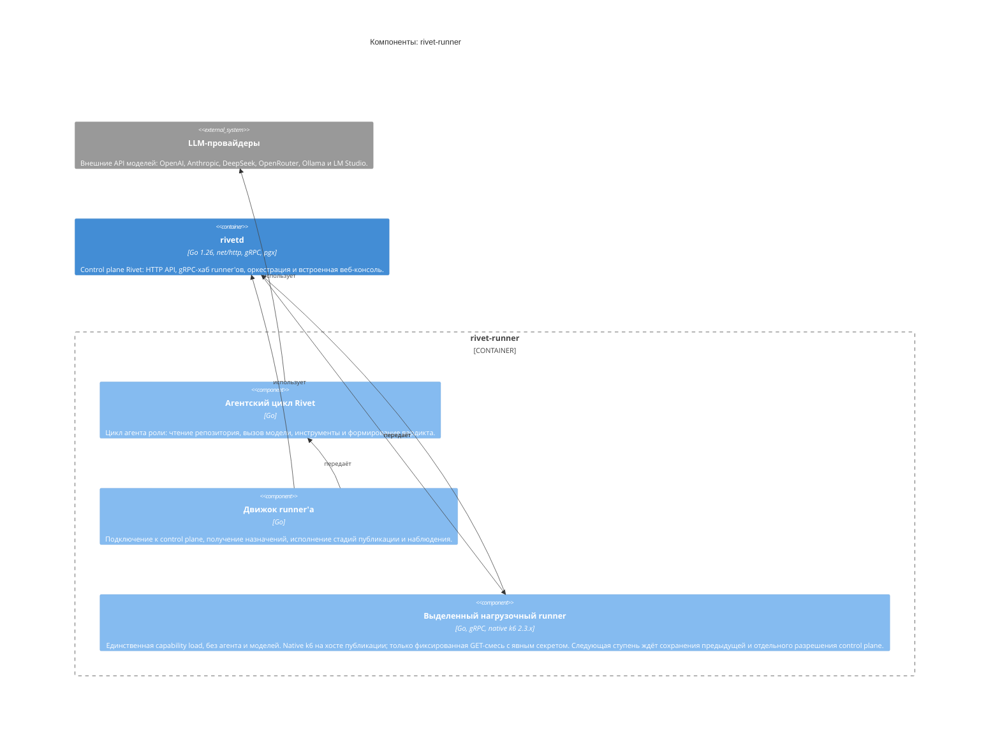

<!-- Сгенерировано командой rivet architecture views. Не редактируй вручную: файл перезаписывается. -->

# Компоненты: rivet-runner

- Контейнеры: [Rivet](../container/system.md)

| Элемент | Название | Вид | Технология | Описание |
|---|---|---|---|---|
| `ext.llm` | LLM-провайдеры | система, внешний | OpenAI/Anthropic-совместимые REST API | Внешние API моделей: OpenAI, Anthropic, DeepSeek, OpenRouter, Ollama и LM Studio. |
| `app.rivetd` | rivetd | контейнер | Go 1.26, net/http, gRPC, pgx | Control plane Rivet: HTTP API, gRPC-хаб runner'ов, оркестрация и встроенная веб-консоль. |
| `app.runner` | rivet-runner | контейнер | Go 1.26, gRPC | Агент на машине пользователя: подключается к control plane и выполняет этапы задач, публикации и проверки. |
| `app.runner.agent` | Агентский цикл Rivet | компонент | Go | Цикл агента роли: чтение репозитория, вызов модели, инструменты и формирование вердикта. |
| `app.runner.engine` | Движок runner'а | компонент | Go | Подключение к control plane, получение назначений, исполнение стадий публикации и наблюдения. |
| `app.runner.k6` | Выделенный нагрузочный runner | компонент | Go, gRPC, native k6 2.3.x | Единственная capability load, без агента и моделей. Native k6 на хосте публикации; только фиксированная GET-смесь с явным секретом. Следующая ступень ждёт сохранения предыдущей и отдельного разрешения control plane. |
