<!-- Сгенерировано командой rivet architecture views. Не редактируй вручную: файл перезаписывается. -->

# Контейнеры: Rivet

- [Контекст](../context.md)
- Компоненты: [rivetd](../component/app.rivetd.md)
- Компоненты: [rivet-runner](../component/app.runner.md)

```mermaid
C4Container
  title Контейнеры: Rivet
  Person_Ext(n_biz_admin, "Администратор установки", "Управляет пользователями, подключениями моделей, агентами и окружениями.")
  Person(n_biz_analyst, "Аналитик", "Роль агента: исследует интервью и отзывы, формирует потребности и бэклог.")
  Person(n_biz_architect, "Архитектор", "Роль агента: описывает и проверяет архитектуру проекта в формате Rivet.")
  Person(n_biz_devops, "Релиз-инженер", "Роль агента: публикует изменения в окружения и оформляет релиз.")
  Person(n_biz_lead, "Тимлид", "Роль агента: раскладывает Epic на план задач и руководит процессом.")
  Person_Ext(n_biz_member, "Участник проекта", "Человек с доступом к задачам, релизам и сессиям проекта.")
  Person_Ext(n_biz_owner, "Владелец проекта", "Человек, который ставит цели, утверждает бэклог и следит за результатом.")
  Person(n_biz_sre, "Инженер сопровождения", "Роль агента: наблюдает за окружениями и описывает инциденты.")
  System_Boundary(n_system, "Rivet") {
    Container(n_app_cli, "rivet CLI", "Go 1.26", "Командная утилита администратора и участника: настройка подключений, импорт истории, проверка архитектуры.")
    Container(n_app_rivetd, "rivetd", "Go 1.26, net/http, gRPC, pgx", "Control plane Rivet: HTTP API, gRPC-хаб runner'ов, оркестрация и встроенная веб-консоль.")
    Container(n_app_runner, "rivet-runner", "Go 1.26, gRPC", "Агент на машине пользователя: подключается к control plane и выполняет этапы задач, публикации и проверки.")
    ContainerDb(n_tech_postgres, "PostgreSQL", "PostgreSQL 17", "Реляционная база с изменяемой моделью Rivet: проекты, эпики, задачи, сессии, релизы, агенты и настройки.")
    ContainerDb(n_tech_s3, "Объектное хранилище", "S3-совместимое хранилище (RustFS в dev, S3 в проде)", "Хранит тяжёлые артефакты сессий — транскрипты; в базе остаются только ссылки s3://.")
  }
  System_Ext(n_ext_gitea, "Gitea / Forgejo", "Хостинг репозитория: REST API, клонирование, PR и webhook'и.")
  System_Ext(n_ext_github, "GitHub", "Хостинг репозитория: REST API, клонирование, PR и webhook'и.")
  System_Ext(n_ext_gitlab, "GitLab", "Хостинг репозитория: REST API, клонирование, MR и webhook'и.")
  System_Ext(n_ext_llm, "LLM-провайдеры", "Внешние API моделей: OpenAI, Anthropic, DeepSeek, OpenRouter, Ollama и LM Studio.")
  Rel(n_app_cli, n_app_rivetd, "использует")
  Rel(n_app_rivetd, n_app_runner, "передаёт")
  Rel(n_app_rivetd, n_ext_gitea, "использует")
  Rel(n_app_rivetd, n_ext_github, "использует")
  Rel(n_app_rivetd, n_ext_gitlab, "использует")
  Rel(n_app_rivetd, n_ext_llm, "использует")
  Rel(n_app_rivetd, n_tech_postgres, "читает Epic, читает Runner, читает Версия политики, читает Задача, читает Запись использования модели, читает Запуск исследования, читает Интервью и отзыв, читает Инцидент, читает Потребность Epic, читает Привязка токена runner'а, читает Проект, читает Публикация, читает Релиз, читает Сессия агента, читает Событие журнала, читает Токен runner'а, читает Этап задачи, читает и пишет Epic, читает и пишет Runner, читает и пишет Агент, читает и пишет Агент команды, читает и пишет Версия политики, читает и пишет Вопрос и сохранённый профиль нагрузки, читает и пишет Задача, читает и пишет Запрос внимания, читает и пишет Запуск исследования, читает и пишет Интервью и отзыв, читает и пишет Инцидент, читает и пишет Конспект исследования, читает и пишет Настройка установки, читает и пишет Окружение, читает и пишет Подключение модели, читает и пишет Пользователь, читает и пишет Попытка нагрузочного тестирования, читает и пишет Потребность Epic, читает и пишет Проект, читает и пишет Публикация, читает и пишет Релиз, читает и пишет Роль агента, читает и пишет Сессия агента, читает и пишет Сессия входа, читает и пишет Снимок архитектуры, читает и пишет Событие журнала, читает и пишет Токен доступа, читает и пишет Участник проекта, читает и пишет Учётные данные SCM, читает и пишет Этап задачи")
  Rel(n_app_runner, n_app_rivetd, "использует, передаёт")
  Rel(n_app_runner, n_ext_llm, "использует")
  Rel(n_biz_admin, n_app_rivetd, "использует")
  Rel(n_biz_analyst, n_app_rivetd, "использует")
  Rel(n_biz_architect, n_app_rivetd, "использует")
  Rel(n_biz_devops, n_app_rivetd, "использует")
  Rel(n_biz_lead, n_app_rivetd, "использует")
  Rel(n_biz_member, n_app_rivetd, "использует")
  Rel(n_biz_owner, n_app_rivetd, "использует")
  Rel(n_biz_sre, n_app_rivetd, "использует")
  Rel(n_ext_gitea, n_app_rivetd, "передаёт")
  Rel(n_ext_github, n_app_rivetd, "передаёт")
  Rel(n_ext_gitlab, n_app_rivetd, "передаёт")
```

| Элемент | Название | Вид | Технология | Описание |
|---|---|---|---|---|
| `biz.admin` | Администратор установки | человек, внешний |  | Управляет пользователями, подключениями моделей, агентами и окружениями. |
| `biz.analyst` | Аналитик | человек |  | Роль агента: исследует интервью и отзывы, формирует потребности и бэклог. |
| `biz.architect` | Архитектор | человек |  | Роль агента: описывает и проверяет архитектуру проекта в формате Rivet. |
| `biz.devops` | Релиз-инженер | человек |  | Роль агента: публикует изменения в окружения и оформляет релиз. |
| `biz.lead` | Тимлид | человек |  | Роль агента: раскладывает Epic на план задач и руководит процессом. |
| `biz.member` | Участник проекта | человек, внешний |  | Человек с доступом к задачам, релизам и сессиям проекта. |
| `biz.owner` | Владелец проекта | человек, внешний |  | Человек, который ставит цели, утверждает бэклог и следит за результатом. |
| `biz.sre` | Инженер сопровождения | человек |  | Роль агента: наблюдает за окружениями и описывает инциденты. |
| `system` | Rivet | система |  | Автономная система разработки: превращает эпики и исследование продукта в выполненные задачи, публикует изменения через SCM и ведёт релизы с наблюдением за окружениями. |
| `ext.gitea` | Gitea / Forgejo | система, внешний | REST + webhooks | Хостинг репозитория: REST API, клонирование, PR и webhook'и. |
| `ext.github` | GitHub | система, внешний | REST + webhooks | Хостинг репозитория: REST API, клонирование, PR и webhook'и. |
| `ext.gitlab` | GitLab | система, внешний | REST + webhooks | Хостинг репозитория: REST API, клонирование, MR и webhook'и. |
| `ext.llm` | LLM-провайдеры | система, внешний | OpenAI/Anthropic-совместимые REST API | Внешние API моделей: OpenAI, Anthropic, DeepSeek, OpenRouter, Ollama и LM Studio. |
| `app.cli` | rivet CLI | контейнер | Go 1.26 | Командная утилита администратора и участника: настройка подключений, импорт истории, проверка архитектуры. |
| `app.rivetd` | rivetd | контейнер | Go 1.26, net/http, gRPC, pgx | Control plane Rivet: HTTP API, gRPC-хаб runner'ов, оркестрация и встроенная веб-консоль. |
| `app.runner` | rivet-runner | контейнер | Go 1.26, gRPC | Агент на машине пользователя: подключается к control plane и выполняет этапы задач, публикации и проверки. |
| `tech.postgres` | PostgreSQL | база данных | PostgreSQL 17 | Реляционная база с изменяемой моделью Rivet: проекты, эпики, задачи, сессии, релизы, агенты и настройки. |
| `tech.s3` | Объектное хранилище | база данных | S3-совместимое хранилище (RustFS в dev, S3 в проде) | Хранит тяжёлые артефакты сессий — транскрипты; в базе остаются только ссылки s3://. |
