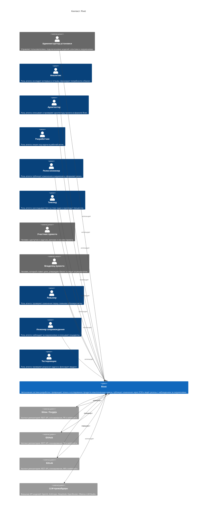

<!-- Сгенерировано командой rivet architecture views. Не редактируй вручную: файл перезаписывается. -->

# Контекст: Rivet

- Контейнеры: [Rivet](container/system.md)
- [Развёртывание](deployment.md)

| Элемент | Название | Вид | Технология | Описание |
|---|---|---|---|---|
| `biz.admin` | Администратор установки | человек, внешний |  | Управляет пользователями, подключениями моделей, агентами и окружениями. |
| `biz.analyst` | Аналитик | человек |  | Роль агента: исследует интервью и отзывы, формирует потребности и бэклог. |
| `biz.architect` | Архитектор | человек |  | Роль агента: описывает и проверяет архитектуру проекта в формате Rivet. |
| `biz.developer` | Разработчик | человек |  | Роль агента: пишет код задачи в рабочей ветке. |
| `biz.devops` | Релиз-инженер | человек |  | Роль агента: публикует изменения в окружения и оформляет релиз. |
| `biz.lead` | Тимлид | человек |  | Роль агента: раскладывает Epic на план задач и руководит процессом. |
| `biz.member` | Участник проекта | человек, внешний |  | Человек с доступом к задачам, релизам и сессиям проекта. |
| `biz.owner` | Владелец проекта | человек, внешний |  | Человек, который ставит цели, утверждает бэклог и следит за результатом. |
| `biz.reviewer` | Ревьюер | человек |  | Роль агента: проверяет изменения перед слиянием в базовую ветку. |
| `biz.sre` | Инженер сопровождения | человек |  | Роль агента: наблюдает за окружениями и описывает инциденты. |
| `biz.tester` | Тестировщик | человек |  | Роль агента: проверяет результат задачи и фиксирует вердикт. |
| `system` | Rivet | система |  | Автономная система разработки: превращает эпики и исследование продукта в выполненные задачи, публикует изменения через SCM и ведёт релизы с наблюдением за окружениями. |
| `ext.gitea` | Gitea / Forgejo | система, внешний | REST + webhooks | Хостинг репозитория: REST API, клонирование, PR и webhook'и. |
| `ext.github` | GitHub | система, внешний | REST + webhooks | Хостинг репозитория: REST API, клонирование, PR и webhook'и. |
| `ext.gitlab` | GitLab | система, внешний | REST + webhooks | Хостинг репозитория: REST API, клонирование, MR и webhook'и. |
| `ext.llm` | LLM-провайдеры | система, внешний | OpenAI/Anthropic-совместимые REST API | Внешние API моделей: OpenAI, Anthropic, DeepSeek, OpenRouter, Ollama и LM Studio. |
