<!-- Сгенерировано командой rivet architecture views. Не редактируй вручную: файл перезаписывается. -->

# Данные

```mermaid
flowchart LR
  subgraph n_type_data_object["Объекты данных"]
    n_data_access_token["Токен доступа"]
    n_data_agent["Агент"]
    n_data_agent_role["Роль агента"]
    n_data_attention["Запрос внимания"]
    n_data_auth_session["Сессия входа"]
    n_data_deployment["Публикация"]
    n_data_discovery_interview["Интервью и отзыв"]
    n_data_discovery_run["Запуск исследования"]
    n_data_discovery_summary["Конспект исследования"]
    n_data_environment["Окружение"]
    n_data_epic["Epic"]
    n_data_epic_dep["Зависимость Epic'ов"]
    n_data_epic_need["Потребность Epic"]
    n_data_event["Событие журнала"]
    n_data_incident["Инцидент"]
    n_data_incident_event["Событие инцидента"]
    n_data_installation_setting["Настройка установки"]
    n_data_load_test_plan["Вопрос и сохранённый профиль нагрузки"]
    n_data_load_test_run["Попытка нагрузочного тестирования"]
    n_data_model_connection["Подключение модели"]
    n_data_monitor_run["Проверка наблюдения"]
    n_data_monitor_state["Состояние наблюдения"]
    n_data_policy_version["Версия политики"]
    n_data_project["Проект"]
    n_data_project_architecture["Снимок архитектуры"]
    n_data_project_member["Участник проекта"]
    n_data_release["Релиз"]
    n_data_runner["Runner"]
    n_data_runner_token["Токен runner'а"]
    n_data_runner_token_binding["Привязка токена runner'а"]
    n_data_scm_credential["Учётные данные SCM"]
    n_data_session["Сессия агента"]
    n_data_task["Задача"]
    n_data_task_dep["Зависимость задач"]
    n_data_task_step_run["Этап задачи"]
    n_data_team_agent["Агент команды"]
    n_data_usage_record["Запись использования модели"]
    n_data_user["Пользователь"]
  end
  n_app_analyst["Аналитик продукта"]
  n_app_api["REST API и SSE"]
  n_app_architecture["Снимок архитектуры"]
  n_app_cycle["Цикл разработки"]
  n_app_discovery["Проверка исследования"]
  n_app_history["Импорт истории"]
  n_app_load_testing["Управление нагрузочными тестами"]
  n_app_ops["Релизы и инциденты"]
  n_app_orchestrator["Оркестратор"]
  n_app_overview["Обзор проекта"]
  n_app_planner["Планировщик"]
  n_app_policy["Движок политик"]
  n_app_stream["gRPC-хаб runner'ов"]
  n_biz_architecture_snapshot["Снимок архитектуры"]
  n_biz_deployment["Публикация"]
  n_biz_environment["Окружение"]
  n_biz_epic["Epic"]
  n_biz_event["Событие журнала"]
  n_biz_incident["Инцидент"]
  n_biz_interview["Интервью и отзыв"]
  n_biz_model_connection["Подключение модели"]
  n_biz_need["Потребность"]
  n_biz_project["Проект"]
  n_biz_release["Релиз"]
  n_biz_runner["Runner"]
  n_biz_session["Сессия агента"]
  n_biz_step_run["Этап задачи"]
  n_biz_task["Задача"]
  n_biz_user["Пользователь"]
  n_tech_postgres["PostgreSQL"]
  n_app_analyst -->|"access: read"| n_data_discovery_interview
  n_app_analyst -->|"access: readwrite"| n_data_discovery_run
  n_app_analyst -->|"access: readwrite"| n_data_discovery_summary
  n_app_api -->|"access: readwrite"| n_data_access_token
  n_app_api -->|"access: readwrite"| n_data_agent
  n_app_api -->|"access: readwrite"| n_data_agent_role
  n_app_api -->|"access: readwrite"| n_data_attention
  n_app_api -->|"access: readwrite"| n_data_auth_session
  n_app_api -->|"access: readwrite"| n_data_deployment
  n_app_api -->|"access: readwrite"| n_data_discovery_interview
  n_app_api -->|"access: readwrite"| n_data_discovery_run
  n_app_api -->|"access: readwrite"| n_data_environment
  n_app_api -->|"access: readwrite"| n_data_epic
  n_app_api -->|"access: readwrite"| n_data_event
  n_app_api -->|"access: readwrite"| n_data_incident
  n_app_api -->|"access: readwrite"| n_data_installation_setting
  n_app_api -->|"access: readwrite"| n_data_model_connection
  n_app_api -->|"access: readwrite"| n_data_policy_version
  n_app_api -->|"access: readwrite"| n_data_project
  n_app_api -->|"access: readwrite"| n_data_project_architecture
  n_app_api -->|"access: readwrite"| n_data_project_member
  n_app_api -->|"access: readwrite"| n_data_release
  n_app_api -->|"access: readwrite"| n_data_runner
  n_app_api -->|"access: readwrite"| n_data_scm_credential
  n_app_api -->|"access: readwrite"| n_data_session
  n_app_api -->|"access: readwrite"| n_data_task
  n_app_api -->|"access: read"| n_data_task_step_run
  n_app_api -->|"access: readwrite"| n_data_team_agent
  n_app_api -->|"access: read"| n_data_usage_record
  n_app_api -->|"access: readwrite"| n_data_user
  n_app_architecture -->|"access: read"| n_data_epic
  n_app_architecture -->|"access: readwrite"| n_data_project_architecture
  n_app_architecture -->|"access: read"| n_data_task
  n_app_cycle -->|"access: read"| n_data_deployment
  n_app_cycle -->|"access: read"| n_data_incident
  n_app_cycle -->|"access: read"| n_data_release
  n_app_discovery -->|"access: read"| n_data_discovery_run
  n_app_discovery -->|"access: readwrite"| n_data_epic
  n_app_discovery -->|"access: readwrite"| n_data_epic_need
  n_app_history -->|"access: readwrite"| n_data_epic
  n_app_history -->|"access: readwrite"| n_data_event
  n_app_history -->|"access: readwrite"| n_data_task
  n_app_load_testing -->|"access: readwrite"| n_data_load_test_plan
  n_app_load_testing -->|"access: readwrite"| n_data_load_test_run
  n_app_ops -->|"access: readwrite"| n_data_incident
  n_app_ops -->|"access: readwrite"| n_data_release
  n_app_orchestrator -->|"access: readwrite"| n_data_deployment
  n_app_orchestrator -->|"access: readwrite"| n_data_epic
  n_app_orchestrator -->|"access: readwrite"| n_data_event
  n_app_orchestrator -->|"access: readwrite"| n_data_incident
  n_app_orchestrator -->|"access: read"| n_data_policy_version
  n_app_orchestrator -->|"access: readwrite"| n_data_release
  n_app_orchestrator -->|"access: read"| n_data_runner
  n_app_orchestrator -->|"access: read"| n_data_session
  n_app_orchestrator -->|"access: readwrite"| n_data_task
  n_app_orchestrator -->|"access: readwrite"| n_data_task_step_run
  n_app_overview -->|"access: read"| n_data_epic
  n_app_overview -->|"access: read"| n_data_event
  n_app_overview -->|"access: read"| n_data_project
  n_app_overview -->|"access: read"| n_data_task
  n_app_overview -->|"access: read"| n_data_usage_record
  n_app_planner -->|"access: readwrite"| n_data_epic
  n_app_planner -->|"access: read"| n_data_epic_need
  n_app_planner -->|"access: readwrite"| n_data_task
  n_app_policy -->|"access: read"| n_data_policy_version
  n_app_stream -->|"access: read"| n_data_runner
  n_app_stream -->|"access: read"| n_data_runner_token
  n_app_stream -->|"access: read"| n_data_runner_token_binding
  n_data_deployment -->|"realization"| n_biz_deployment
  n_data_discovery_interview -->|"realization"| n_biz_interview
  n_data_environment -->|"realization"| n_biz_environment
  n_data_epic -->|"realization"| n_biz_epic
  n_data_epic_dep ---|"association"| n_data_epic
  n_data_epic_need -->|"realization"| n_biz_need
  n_data_epic_need ---|"association"| n_data_epic
  n_data_event -->|"realization"| n_biz_event
  n_data_incident -->|"realization"| n_biz_incident
  n_data_model_connection -->|"realization"| n_biz_model_connection
  n_data_project -->|"realization"| n_biz_project
  n_data_project_architecture -->|"realization"| n_biz_architecture_snapshot
  n_data_project_member ---|"association"| n_data_user
  n_data_release -->|"realization"| n_biz_release
  n_data_runner -->|"realization"| n_biz_runner
  n_data_session -->|"realization"| n_biz_session
  n_data_task -->|"realization"| n_biz_task
  n_data_task_dep ---|"association"| n_data_task
  n_data_task_step_run -->|"realization"| n_biz_step_run
  n_data_user -->|"realization"| n_biz_user
  n_tech_postgres -->|"access: readwrite"| n_data_access_token
  n_tech_postgres -->|"access: readwrite"| n_data_agent
  n_tech_postgres -->|"access: readwrite"| n_data_agent_role
  n_tech_postgres -->|"access: readwrite"| n_data_attention
  n_tech_postgres -->|"access: readwrite"| n_data_auth_session
  n_tech_postgres -->|"access: readwrite"| n_data_deployment
  n_tech_postgres -->|"access: readwrite"| n_data_discovery_interview
  n_tech_postgres -->|"access: readwrite"| n_data_discovery_run
  n_tech_postgres -->|"access: readwrite"| n_data_discovery_summary
  n_tech_postgres -->|"access: readwrite"| n_data_environment
  n_tech_postgres -->|"access: readwrite"| n_data_epic
  n_tech_postgres -->|"access: readwrite"| n_data_epic_dep
  n_tech_postgres -->|"access: readwrite"| n_data_epic_need
  n_tech_postgres -->|"access: readwrite"| n_data_event
  n_tech_postgres -->|"access: readwrite"| n_data_incident
  n_tech_postgres -->|"access: readwrite"| n_data_incident_event
  n_tech_postgres -->|"access: readwrite"| n_data_installation_setting
  n_tech_postgres -->|"access: readwrite"| n_data_load_test_plan
  n_tech_postgres -->|"access: readwrite"| n_data_load_test_run
  n_tech_postgres -->|"access: readwrite"| n_data_model_connection
  n_tech_postgres -->|"access: readwrite"| n_data_monitor_run
  n_tech_postgres -->|"access: readwrite"| n_data_monitor_state
  n_tech_postgres -->|"access: readwrite"| n_data_policy_version
  n_tech_postgres -->|"access: readwrite"| n_data_project
  n_tech_postgres -->|"access: readwrite"| n_data_project_architecture
  n_tech_postgres -->|"access: readwrite"| n_data_project_member
  n_tech_postgres -->|"access: readwrite"| n_data_release
  n_tech_postgres -->|"access: readwrite"| n_data_runner
  n_tech_postgres -->|"access: readwrite"| n_data_runner_token
  n_tech_postgres -->|"access: readwrite"| n_data_runner_token_binding
  n_tech_postgres -->|"access: readwrite"| n_data_scm_credential
  n_tech_postgres -->|"access: readwrite"| n_data_session
  n_tech_postgres -->|"access: readwrite"| n_data_task
  n_tech_postgres -->|"access: readwrite"| n_data_task_dep
  n_tech_postgres -->|"access: readwrite"| n_data_task_step_run
  n_tech_postgres -->|"access: readwrite"| n_data_team_agent
  n_tech_postgres -->|"access: readwrite"| n_data_usage_record
  n_tech_postgres -->|"access: readwrite"| n_data_user
  classDef added fill:#e6f4ea,stroke:#1e8e3e,color:#0d652d
  classDef modified fill:#fef7e0,stroke:#e37400,color:#7a4100
  classDef removed fill:#fce8e6,stroke:#d93025,color:#a50e0e,stroke-dasharray: 5 5
  classDef ext fill:#f1f3f4,stroke:#9aa0a6,color:#5f6368,stroke-dasharray: 3 3
  class n_app_analyst,n_app_api,n_app_architecture,n_app_cycle,n_app_discovery,n_app_history,n_app_load_testing,n_app_ops,n_app_orchestrator,n_app_overview,n_app_planner,n_app_policy,n_app_stream,n_biz_architecture_snapshot,n_biz_deployment,n_biz_environment,n_biz_epic,n_biz_event,n_biz_incident,n_biz_interview,n_biz_model_connection,n_biz_need,n_biz_project,n_biz_release,n_biz_runner,n_biz_session,n_biz_step_run,n_biz_task,n_biz_user,n_tech_postgres ext
```

| Элемент | Тип | Название | Описание |
|---|---|---|---|
| `data.access-token` | data-object | Токен доступа |  |
| `data.agent` | data-object | Агент |  |
| `data.agent-role` | data-object | Роль агента |  |
| `data.attention` | data-object | Запрос внимания |  |
| `data.auth-session` | data-object | Сессия входа |  |
| `data.deployment` | data-object | Публикация |  |
| `data.discovery-interview` | data-object | Интервью и отзыв |  |
| `data.discovery-run` | data-object | Запуск исследования |  |
| `data.discovery-summary` | data-object | Конспект исследования |  |
| `data.environment` | data-object | Окружение |  |
| `data.epic` | data-object | Epic |  |
| `data.epic-dep` | data-object | Зависимость Epic'ов |  |
| `data.epic-need` | data-object | Потребность Epic |  |
| `data.event` | data-object | Событие журнала |  |
| `data.incident` | data-object | Инцидент |  |
| `data.incident-event` | data-object | Событие инцидента |  |
| `data.installation-setting` | data-object | Настройка установки |  |
| `data.load-test-plan` | data-object | Вопрос и сохранённый профиль нагрузки |  |
| `data.load-test-run` | data-object | Попытка нагрузочного тестирования |  |
| `data.model-connection` | data-object | Подключение модели |  |
| `data.monitor-run` | data-object | Проверка наблюдения |  |
| `data.monitor-state` | data-object | Состояние наблюдения |  |
| `data.policy-version` | data-object | Версия политики |  |
| `data.project` | data-object | Проект |  |
| `data.project-architecture` | data-object | Снимок архитектуры |  |
| `data.project-member` | data-object | Участник проекта |  |
| `data.release` | data-object | Релиз |  |
| `data.runner` | data-object | Runner |  |
| `data.runner-token` | data-object | Токен runner'а |  |
| `data.runner-token-binding` | data-object | Привязка токена runner'а |  |
| `data.scm-credential` | data-object | Учётные данные SCM |  |
| `data.session` | data-object | Сессия агента |  |
| `data.task` | data-object | Задача |  |
| `data.task-dep` | data-object | Зависимость задач |  |
| `data.task-step-run` | data-object | Этап задачи |  |
| `data.team-agent` | data-object | Агент команды |  |
| `data.usage-record` | data-object | Запись использования модели |  |
| `data.user` | data-object | Пользователь |  |
