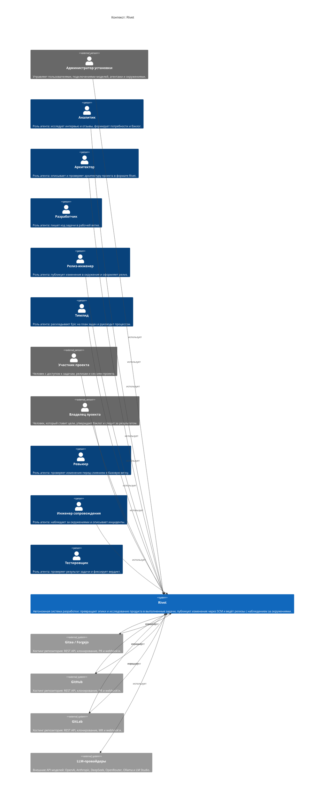
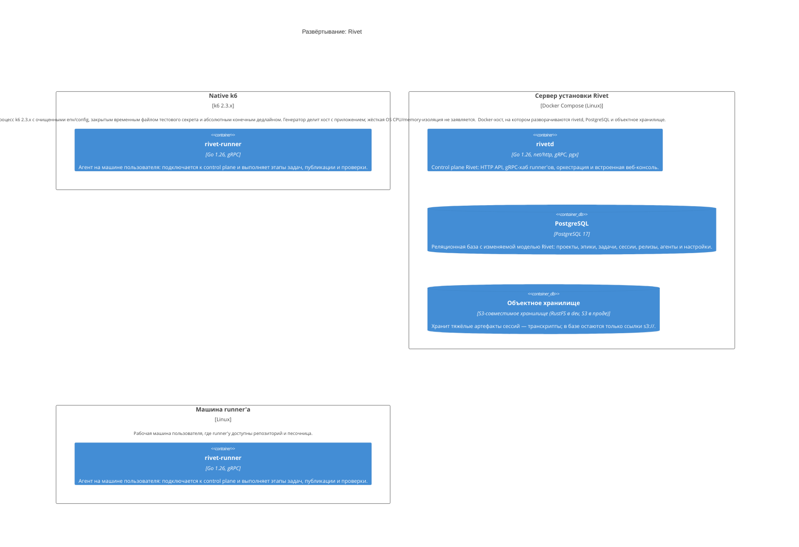

<!-- Сгенерировано командой rivet architecture views. Не редактируй вручную: файл перезаписывается. -->

# HLD: Rivet

Обзор архитектуры верхнего уровня. Документ собран из описания архитектуры, подробности в [C4-схемах](c4/context.md) и [представлениях слоёв](README.md).

## Назначение и принципы

Автономная система разработки: превращает эпики и исследование продукта в выполненные задачи, публикует изменения через SCM и ведёт релизы с наблюдением за окружениями.

| Принцип | Формулировка | Обоснование |
|---|---|---|
| `p.postgres-single-source` | PostgreSQL — единственный источник истины состояния | Вся изменяемая модель (проекты, эпики, задачи, сессии, релизы) живёт в одной базе; объектное хранилище держит только тяжёлые артефакты по ссылке. |
| `p.pull-protocol` | Runner'ы сами забирают работу по gRPC | Control plane не адресует runner'ов напрямую: runner регистрируется и получает этапы через двунаправленный поток, поэтому очередей сообщений нет. |
| `p.llm-scope` | Модель решает задачу, оркестратор управляет процессом | Детерминированные переходы статусов и проверки находятся в коде, а LLM используется для планирования, анализа, разработки, тестирования и review. |
| `p.local-runner` | Runner выполняется в среде пользователя | Код и песочница находятся на машине runner'а; control plane хранит только отчёты и метаданные сессий. |

## Контекст (L1)

Подробнее: [c4/context.md](c4/context.md).

## Контейнеры (L2)

```mermaid
C4Container
  title Контейнеры: Rivet
  Person_Ext(n_biz_admin, "Администратор установки", "Управляет пользователями, подключениями моделей, агентами и окружениями.")
  Person(n_biz_analyst, "Аналитик", "Роль агента: исследует интервью и отзывы, формирует потребности и бэклог.")
  Person(n_biz_architect, "Архитектор", "Роль агента: описывает и проверяет архитектуру проекта в формате Rivet.")
  Person(n_biz_devops, "Релиз-инженер", "Роль агента: публикует изменения в окружения и оформляет релиз.")
  Person(n_biz_lead, "Тимлид", "Роль агента: раскладывает Epic на план задач и руководит процессом.")
  Person_Ext(n_biz_member, "Участник проекта", "Человек с доступом к задачам, релизам и сессиям проекта.")
  Person_Ext(n_biz_owner, "Владелец проекта", "Человек, который ставит цели, утверждает бэклог и следит за результатом.")
  Person(n_biz_sre, "Инженер сопровождения", "Роль агента: наблюдает за окружениями и описывает инциденты.")
  System_Boundary(n_system, "Rivet") {
    Container(n_app_cli, "rivet CLI", "Go 1.26", "Командная утилита администратора и участника: настройка подключений, импорт истории, проверка архитектуры.")
    Container(n_app_rivetd, "rivetd", "Go 1.26, net/http, gRPC, pgx", "Control plane Rivet: HTTP API, gRPC-хаб runner'ов, оркестрация и встроенная веб-консоль.")
    Container(n_app_runner, "rivet-runner", "Go 1.26, gRPC", "Агент на машине пользователя: подключается к control plane и выполняет этапы задач, публикации и проверки.")
    ContainerDb(n_tech_postgres, "PostgreSQL", "PostgreSQL 17", "Реляционная база с изменяемой моделью Rivet: проекты, эпики, задачи, сессии, релизы, агенты и настройки.")
    ContainerDb(n_tech_s3, "Объектное хранилище", "S3-совместимое хранилище (RustFS в dev, S3 в проде)", "Хранит тяжёлые артефакты сессий — транскрипты; в базе остаются только ссылки s3://.")
  }
  System_Ext(n_ext_gitea, "Gitea / Forgejo", "Хостинг репозитория: REST API, клонирование, PR и webhook'и.")
  System_Ext(n_ext_github, "GitHub", "Хостинг репозитория: REST API, клонирование, PR и webhook'и.")
  System_Ext(n_ext_gitlab, "GitLab", "Хостинг репозитория: REST API, клонирование, MR и webhook'и.")
  System_Ext(n_ext_llm, "LLM-провайдеры", "Внешние API моделей: OpenAI, Anthropic, DeepSeek, OpenRouter, Ollama и LM Studio.")
  Rel(n_app_cli, n_app_rivetd, "использует")
  Rel(n_app_rivetd, n_app_runner, "передаёт")
  Rel(n_app_rivetd, n_ext_gitea, "использует")
  Rel(n_app_rivetd, n_ext_github, "использует")
  Rel(n_app_rivetd, n_ext_gitlab, "использует")
  Rel(n_app_rivetd, n_ext_llm, "использует")
  Rel(n_app_rivetd, n_tech_postgres, "читает Epic, читает Runner, читает Версия политики, читает Задача, читает Запись использования модели, читает Запуск исследования, читает Интервью и отзыв, читает Инцидент, читает Потребность Epic, читает Привязка токена runner'а, читает Проект, читает Публикация, читает Релиз, читает Сессия агента, читает Событие журнала, читает Токен runner'а, читает Этап задачи, читает и пишет Epic, читает и пишет Runner, читает и пишет Агент, читает и пишет Агент команды, читает и пишет Версия политики, читает и пишет Вопрос и сохранённый профиль нагрузки, читает и пишет Задача, читает и пишет Запрос внимания, читает и пишет Запуск исследования, читает и пишет Интервью и отзыв, читает и пишет Инцидент, читает и пишет Конспект исследования, читает и пишет Настройка установки, читает и пишет Окружение, читает и пишет Подключение модели, читает и пишет Пользователь, читает и пишет Попытка нагрузочного тестирования, читает и пишет Потребность Epic, читает и пишет Проект, читает и пишет Публикация, читает и пишет Релиз, читает и пишет Роль агента, читает и пишет Сессия агента, читает и пишет Сессия входа, читает и пишет Снимок архитектуры, читает и пишет Событие журнала, читает и пишет Токен доступа, читает и пишет Участник проекта, читает и пишет Учётные данные SCM, читает и пишет Этап задачи")
  Rel(n_app_runner, n_app_rivetd, "использует, передаёт")
  Rel(n_app_runner, n_ext_llm, "использует")
  Rel(n_biz_admin, n_app_rivetd, "использует")
  Rel(n_biz_analyst, n_app_rivetd, "использует")
  Rel(n_biz_architect, n_app_rivetd, "использует")
  Rel(n_biz_devops, n_app_rivetd, "использует")
  Rel(n_biz_lead, n_app_rivetd, "использует")
  Rel(n_biz_member, n_app_rivetd, "использует")
  Rel(n_biz_owner, n_app_rivetd, "использует")
  Rel(n_biz_sre, n_app_rivetd, "использует")
  Rel(n_ext_gitea, n_app_rivetd, "передаёт")
  Rel(n_ext_github, n_app_rivetd, "передаёт")
  Rel(n_ext_gitlab, n_app_rivetd, "передаёт")
```

| Контейнер | Вид | Технология | Описание |
|---|---|---|---|
| rivet CLI (`app.cli`) | контейнер | Go 1.26 | Командная утилита администратора и участника: настройка подключений, импорт истории, проверка архитектуры. |
| rivetd (`app.rivetd`) | контейнер | Go 1.26, net/http, gRPC, pgx | Control plane Rivet: HTTP API, gRPC-хаб runner'ов, оркестрация и встроенная веб-консоль. |
| rivet-runner (`app.runner`) | контейнер | Go 1.26, gRPC | Агент на машине пользователя: подключается к control plane и выполняет этапы задач, публикации и проверки. |
| PostgreSQL (`tech.postgres`) | база данных | PostgreSQL 17 | Реляционная база с изменяемой моделью Rivet: проекты, эпики, задачи, сессии, релизы, агенты и настройки. |
| Объектное хранилище (`tech.s3`) | база данных | S3-совместимое хранилище (RustFS в dev, S3 в проде) | Хранит тяжёлые артефакты сессий — транскрипты; в базе остаются только ссылки s3://. |

## Ключевые бизнес-процессы

| Процесс | Участвуют | Представление |
|---|---|---|
| Описание архитектуры (`biz.proc.architecture`) | Архитектор, Владелец проекта | [processes/biz.proc.architecture.md](processes/biz.proc.architecture.md) |
| Исследование продукта (`biz.proc.discovery`) | Аналитик, Владелец проекта | [processes/biz.proc.discovery.md](processes/biz.proc.discovery.md) |
| Выполнение Epic (`biz.proc.epic`) | Разработчик, Тимлид, Владелец проекта, Ревьюер | [processes/biz.proc.epic.md](processes/biz.proc.epic.md) |
| Релиз и наблюдение (`biz.proc.release`) | Релиз-инженер, Владелец проекта, Инженер сопровождения | [processes/biz.proc.release.md](processes/biz.proc.release.md) |

## Данные

| Объект данных | Читают | Пишут | Хранится в |
|---|---|---|---|
| Токен доступа (`data.access-token`) | REST API и SSE | REST API и SSE | PostgreSQL |
| Агент (`data.agent`) | REST API и SSE | REST API и SSE | PostgreSQL |
| Роль агента (`data.agent-role`) | REST API и SSE | REST API и SSE | PostgreSQL |
| Запрос внимания (`data.attention`) | REST API и SSE | REST API и SSE | PostgreSQL |
| Сессия входа (`data.auth-session`) | REST API и SSE | REST API и SSE | PostgreSQL |
| Публикация (`data.deployment`) | REST API и SSE, Оркестратор, Цикл разработки | REST API и SSE, Оркестратор | PostgreSQL |
| Интервью и отзыв (`data.discovery-interview`) | REST API и SSE, Аналитик продукта | REST API и SSE | PostgreSQL |
| Запуск исследования (`data.discovery-run`) | REST API и SSE, Аналитик продукта, Проверка исследования | REST API и SSE, Аналитик продукта | PostgreSQL |
| Конспект исследования (`data.discovery-summary`) | Аналитик продукта | Аналитик продукта | PostgreSQL |
| Окружение (`data.environment`) | REST API и SSE | REST API и SSE | PostgreSQL |
| Epic (`data.epic`) | REST API и SSE, Импорт истории, Обзор проекта, Оркестратор, Планировщик, Проверка исследования, Снимок архитектуры | REST API и SSE, Импорт истории, Оркестратор, Планировщик, Проверка исследования | PostgreSQL |
| Зависимость Epic'ов (`data.epic-dep`) | нет | нет | PostgreSQL |
| Потребность Epic (`data.epic-need`) | Планировщик, Проверка исследования | Проверка исследования | PostgreSQL |
| Событие журнала (`data.event`) | REST API и SSE, Импорт истории, Обзор проекта, Оркестратор | REST API и SSE, Импорт истории, Оркестратор | PostgreSQL |
| Инцидент (`data.incident`) | REST API и SSE, Оркестратор, Релизы и инциденты, Цикл разработки | REST API и SSE, Оркестратор, Релизы и инциденты | PostgreSQL |
| Событие инцидента (`data.incident-event`) | нет | нет | PostgreSQL |
| Настройка установки (`data.installation-setting`) | REST API и SSE | REST API и SSE | PostgreSQL |
| Вопрос и сохранённый профиль нагрузки (`data.load-test-plan`) | Управление нагрузочными тестами | Управление нагрузочными тестами | PostgreSQL |
| Попытка нагрузочного тестирования (`data.load-test-run`) | Управление нагрузочными тестами | Управление нагрузочными тестами | PostgreSQL |
| Подключение модели (`data.model-connection`) | REST API и SSE | REST API и SSE | PostgreSQL |
| Проверка наблюдения (`data.monitor-run`) | нет | нет | PostgreSQL |
| Состояние наблюдения (`data.monitor-state`) | нет | нет | PostgreSQL |
| Версия политики (`data.policy-version`) | REST API и SSE, Движок политик, Оркестратор | REST API и SSE | PostgreSQL |
| Проект (`data.project`) | REST API и SSE, Обзор проекта | REST API и SSE | PostgreSQL |
| Снимок архитектуры (`data.project-architecture`) | REST API и SSE, Снимок архитектуры | REST API и SSE, Снимок архитектуры | PostgreSQL |
| Участник проекта (`data.project-member`) | REST API и SSE | REST API и SSE | PostgreSQL |
| Релиз (`data.release`) | REST API и SSE, Оркестратор, Релизы и инциденты, Цикл разработки | REST API и SSE, Оркестратор, Релизы и инциденты | PostgreSQL |
| Runner (`data.runner`) | REST API и SSE, gRPC-хаб runner'ов, Оркестратор | REST API и SSE | PostgreSQL |
| Токен runner'а (`data.runner-token`) | gRPC-хаб runner'ов | нет | PostgreSQL |
| Привязка токена runner'а (`data.runner-token-binding`) | gRPC-хаб runner'ов | нет | PostgreSQL |
| Учётные данные SCM (`data.scm-credential`) | REST API и SSE | REST API и SSE | PostgreSQL |
| Сессия агента (`data.session`) | REST API и SSE, Оркестратор | REST API и SSE | PostgreSQL |
| Задача (`data.task`) | REST API и SSE, Импорт истории, Обзор проекта, Оркестратор, Планировщик, Снимок архитектуры | REST API и SSE, Импорт истории, Оркестратор, Планировщик | PostgreSQL |
| Зависимость задач (`data.task-dep`) | нет | нет | PostgreSQL |
| Этап задачи (`data.task-step-run`) | REST API и SSE, Оркестратор | Оркестратор | PostgreSQL |
| Агент команды (`data.team-agent`) | REST API и SSE | REST API и SSE | PostgreSQL |
| Запись использования модели (`data.usage-record`) | REST API и SSE, Обзор проекта | нет | PostgreSQL |
| Пользователь (`data.user`) | REST API и SSE | REST API и SSE | PostgreSQL |

ERD: [общая схема](erd/all.md), по хранилищам: [PostgreSQL](erd/tech.postgres.md).

## Развёртывание

Подробнее: [c4/deployment.md](c4/deployment.md).

## Внешние интеграции

| Внешняя система | Описание | Связи |
|---|---|---|
| Gitea / Forgejo (`ext.gitea`) | Хостинг репозитория: REST API, клонирование, PR и webhook'и. | Gitea / Forgejo → Rivet: передаёт, Rivet → Gitea / Forgejo: использует |
| GitHub (`ext.github`) | Хостинг репозитория: REST API, клонирование, PR и webhook'и. | GitHub → Rivet: передаёт, Rivet → GitHub: использует |
| GitLab (`ext.gitlab`) | Хостинг репозитория: REST API, клонирование, MR и webhook'и. | GitLab → Rivet: передаёт, Rivet → GitLab: использует |
| LLM-провайдеры (`ext.llm`) | Внешние API моделей: OpenAI, Anthropic, DeepSeek, OpenRouter, Ollama и LM Studio. | Rivet → LLM-провайдеры: использует |

## Ключевые сценарии

| Сценарий | Участники | Представление |
|---|---|---|
| Описание архитектуры проекта (`sc.architecture-describe`) | Владелец проекта, REST API и SSE, Оркестратор, gRPC-хаб runner'ов, Движок runner'а, Агентский цикл Rivet, LLM-провайдеры, Снимок архитектуры, PostgreSQL | [scenarios/sc.architecture-describe.md](scenarios/sc.architecture-describe.md) |
| Публикация окружения и release notes (`sc.deployment`) | Релиз-инженер, REST API и SSE, Оркестратор, gRPC-хаб runner'ов, Движок runner'а, Релизы и инциденты, PostgreSQL | [scenarios/sc.deployment.md](scenarios/sc.deployment.md) |
| Декомпозиция Epic в план задач (`sc.epic-decompose`) | Владелец проекта, REST API и SSE, Планировщик, Клиенты моделей, LLM-провайдеры, PostgreSQL | [scenarios/sc.epic-decompose.md](scenarios/sc.epic-decompose.md) |
| Явное нагрузочное тестирование рабочего локального релиза (`sc.load-testing`) | Владелец проекта, REST API и SSE, Управление нагрузочными тестами, gRPC-хаб runner'ов, Выделенный нагрузочный runner, Native k6, PostgreSQL | [scenarios/sc.load-testing.md](scenarios/sc.load-testing.md) |
| Анализ интервью и утверждение бэклога (`sc.product-discovery`) | Владелец проекта, REST API и SSE, Аналитик продукта, Проверка исследования, Клиенты моделей, LLM-провайдеры, PostgreSQL | [scenarios/sc.product-discovery.md](scenarios/sc.product-discovery.md) |
| Назначение и выполнение этапа runner'ом (`sc.runner-execution`) | Оркестратор, gRPC-хаб runner'ов, Движок runner'а, Агентский цикл Rivet, LLM-провайдеры, PostgreSQL | [scenarios/sc.runner-execution.md](scenarios/sc.runner-execution.md) |

## Архитектурные решения

Принятые решения. Полный журнал со всеми статусами: [adr.md](adr.md).

- [0001. PostgreSQL — единственный источник истины состояния](../adr/0001-postgres-single-store.md)
- [0002. Разделение на развёртываемые Go-бинарники](../adr/0002-go-deployable-layout.md)
- [0003. Pull-протокол runner'ов без очереди сообщений](../adr/0003-pull-protocol.md)
- [0004. Политики проекта как данные и встроенный движок OPA/Rego](../adr/0004-embedded-policy-engine.md)
- [0005. Мультивендорные адаптеры SCM и LLM](../adr/0005-scm-and-llm-adapters.md)
- [0006. Транскрипты сессий в объектном хранилище](../adr/0006-s3-transcripts.md)

## Изменения архитектуры в работе

Изменений в работе нет.
