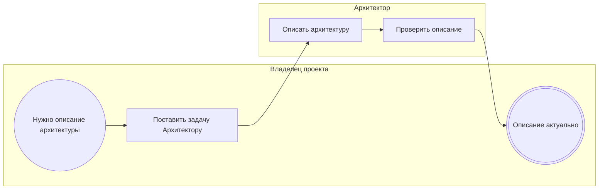

<!-- Сгенерировано командой rivet architecture views. Не редактируй вручную: файл перезаписывается. -->

# Процесс: Описание архитектуры (`biz.proc.architecture`)

Постановка задачи описания архитектуры и проверка результата в формате Rivet.

| Дорожка | Элемент модели |
|---|---|
| Владелец проекта | `biz.owner` |
| Архитектор | `biz.architect` |

| Сервисная задача | Элемент модели |
|---|---|
| Поставить задачу Архитектору | `app.orchestration-service` |
| Описать архитектуру | `app.architecture-service` |
| Проверить описание | `app.architecture-service` |
