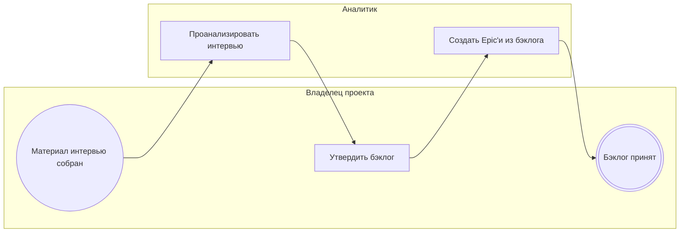

<!-- Сгенерировано командой rivet architecture views. Не редактируй вручную: файл перезаписывается. -->

# Процесс: Исследование продукта (`biz.proc.discovery`)

Загрузка интервью, анализ Аналитиком и утверждение бэклога владельцем.

| Дорожка | Элемент модели |
|---|---|
| Владелец проекта | `biz.owner` |
| Аналитик | `biz.analyst` |

| Сервисная задача | Элемент модели |
|---|---|
| Проанализировать интервью | `app.discovery-service` |
| Создать Epic'и из бэклога | `app.discovery-service` |
