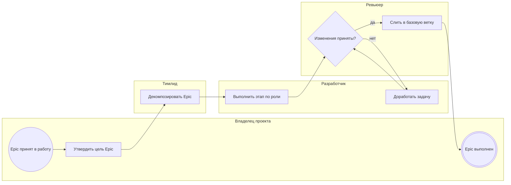

<!-- Сгенерировано командой rivet architecture views. Не редактируй вручную: файл перезаписывается. -->

# Процесс: Выполнение Epic (`biz.proc.epic`)

Планирование Epic, выполнение задач по ролям и слияние результата.

| Дорожка | Элемент модели |
|---|---|
| Владелец проекта | `biz.owner` |
| Тимлид | `biz.lead` |
| Разработчик | `biz.developer` |
| Ревьюер | `biz.reviewer` |

| Сервисная задача | Элемент модели |
|---|---|
| Декомпозировать Epic | `app.planning-service` |
| Выполнить этап по роли | `app.orchestration-service` |
| Доработать задачу | `app.orchestration-service` |
| Слить в базовую ветку | `app.orchestration-service` |
