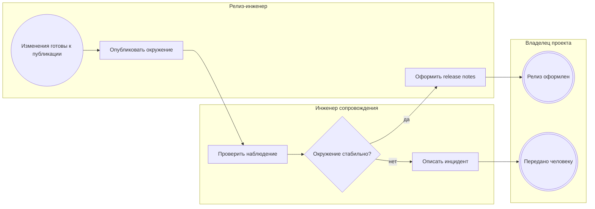

<!-- Сгенерировано командой rivet architecture views. Не редактируй вручную: файл перезаписывается. -->

# Процесс: Релиз и наблюдение (`biz.proc.release`)

Публикация окружений, формирование релиза и обработка инцидентов.

| Дорожка | Элемент модели |
|---|---|
| Релиз-инженер | `biz.devops` |
| Инженер сопровождения | `biz.sre` |
| Владелец проекта | `biz.owner` |

| Сервисная задача | Элемент модели |
|---|---|
| Опубликовать окружение | `app.orchestration-service` |
| Проверить наблюдение | `app.release-service` |
| Оформить release notes | `app.release-service` |
| Описать инцидент | `app.release-service` |
