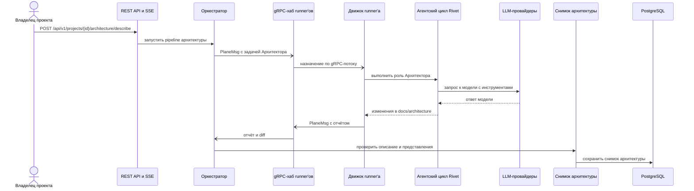

<!-- Сгенерировано командой rivet architecture views. Не редактируй вручную: файл перезаписывается. -->

# Сценарий: Описание архитектуры проекта

Процесс: [Описание архитектуры](../processes/biz.proc.architecture.md).

| Участник | Элемент | Вид |
|---|---|---|
| Владелец проекта | `biz.owner` | человек |
| REST API и SSE | `app.api` | участник |
| Оркестратор | `app.orchestrator` | участник |
| gRPC-хаб runner'ов | `app.stream` | участник |
| Движок runner'а | `app.runner.engine` | участник |
| Агентский цикл Rivet | `app.runner.agent` | участник |
| LLM-провайдеры | `ext.llm` | участник |
| Снимок архитектуры | `app.architecture` | участник |
| PostgreSQL | `tech.postgres` | участник |
