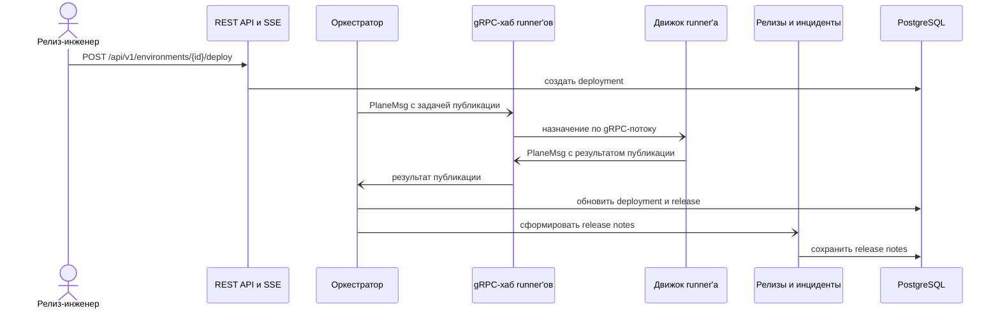

<!-- Сгенерировано командой rivet architecture views. Не редактируй вручную: файл перезаписывается. -->

# Сценарий: Публикация окружения и release notes

Процесс: [Релиз и наблюдение](../processes/biz.proc.release.md).

| Участник | Элемент | Вид |
|---|---|---|
| Релиз-инженер | `biz.devops` | человек |
| REST API и SSE | `app.api` | участник |
| Оркестратор | `app.orchestrator` | участник |
| gRPC-хаб runner'ов | `app.stream` | участник |
| Движок runner'а | `app.runner.engine` | участник |
| Релизы и инциденты | `app.ops` | участник |
| PostgreSQL | `tech.postgres` | участник |
