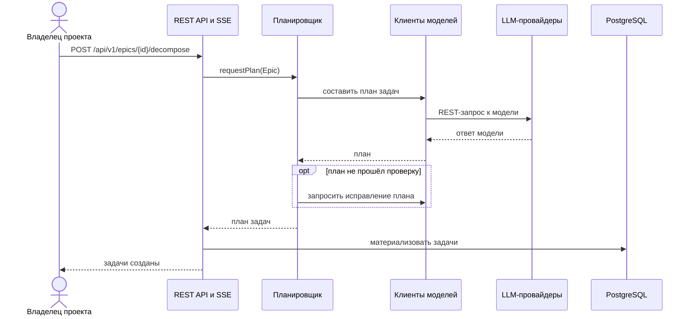

<!-- Сгенерировано командой rivet architecture views. Не редактируй вручную: файл перезаписывается. -->

# Сценарий: Декомпозиция Epic в план задач

Процесс: [Выполнение Epic](../processes/biz.proc.epic.md).

| Участник | Элемент | Вид |
|---|---|---|
| Владелец проекта | `biz.owner` | человек |
| REST API и SSE | `app.api` | участник |
| Планировщик | `app.planner` | участник |
| Клиенты моделей | `app.llm` | участник |
| LLM-провайдеры | `ext.llm` | участник |
| PostgreSQL | `tech.postgres` | участник |
