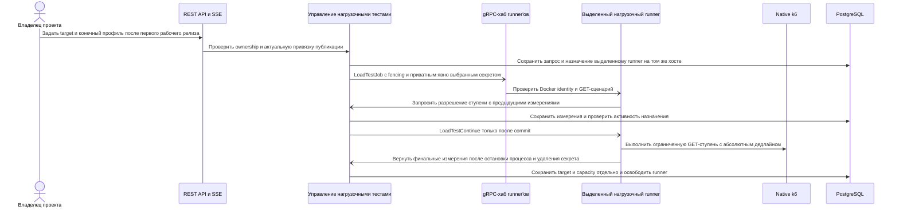

<!-- Сгенерировано командой rivet architecture views. Не редактируй вручную: файл перезаписывается. -->

# Сценарий: Явное нагрузочное тестирование рабочего локального релиза

| Участник | Элемент | Вид |
|---|---|---|
| Владелец проекта | `biz.owner` | человек |
| REST API и SSE | `app.api` | участник |
| Управление нагрузочными тестами | `app.load-testing` | участник |
| gRPC-хаб runner'ов | `app.stream` | участник |
| Выделенный нагрузочный runner | `app.runner.k6` | участник |
| Native k6 | `tech.k6` | участник |
| PostgreSQL | `tech.postgres` | участник |
