<!-- Сгенерировано командой rivet architecture views. Не редактируй вручную: файл перезаписывается. -->

# Технологии

```mermaid
flowchart LR
  subgraph n_type_node["Узлы"]
    n_tech_node_plane["Сервер установки Rivet"]
    n_tech_node_runner["Машина runner'а"]
  end
  subgraph n_type_system_software["Системное ПО"]
    n_tech_postgres["PostgreSQL"]
    n_tech_s3["Объектное хранилище"]
  end
  n_app_rivetd["rivetd"]
  n_app_runner["rivet-runner"]
  n_data_access_token["Токен доступа"]
  n_data_agent["Агент"]
  n_data_agent_role["Роль агента"]
  n_data_attention["Запрос внимания"]
  n_data_auth_session["Сессия входа"]
  n_data_deployment["Публикация"]
  n_data_discovery_interview["Интервью и отзыв"]
  n_data_discovery_run["Запуск исследования"]
  n_data_discovery_summary["Конспект исследования"]
  n_data_environment["Окружение"]
  n_data_epic["Epic"]
  n_data_epic_dep["Зависимость Epic'ов"]
  n_data_epic_need["Потребность Epic"]
  n_data_event["Событие журнала"]
  n_data_incident["Инцидент"]
  n_data_incident_event["Событие инцидента"]
  n_data_installation_setting["Настройка установки"]
  n_data_model_connection["Подключение модели"]
  n_data_monitor_run["Проверка наблюдения"]
  n_data_monitor_state["Состояние наблюдения"]
  n_data_policy_version["Версия политики"]
  n_data_project["Проект"]
  n_data_project_architecture["Снимок архитектуры"]
  n_data_project_member["Участник проекта"]
  n_data_release["Релиз"]
  n_data_runner["Runner"]
  n_data_runner_token["Токен runner'а"]
  n_data_runner_token_binding["Привязка токена runner'а"]
  n_data_scm_credential["Учётные данные SCM"]
  n_data_session["Сессия агента"]
  n_data_task["Задача"]
  n_data_task_dep["Зависимость задач"]
  n_data_task_step_run["Этап задачи"]
  n_data_team_agent["Агент команды"]
  n_data_usage_record["Запись использования модели"]
  n_data_user["Пользователь"]
  n_tech_node_plane -->|"serving"| n_app_rivetd
  n_tech_node_plane -->|"serving"| n_tech_postgres
  n_tech_node_plane -->|"serving"| n_tech_s3
  n_tech_node_runner -->|"serving"| n_app_runner
  n_tech_postgres -->|"access: readwrite"| n_data_access_token
  n_tech_postgres -->|"access: readwrite"| n_data_agent
  n_tech_postgres -->|"access: readwrite"| n_data_agent_role
  n_tech_postgres -->|"access: readwrite"| n_data_attention
  n_tech_postgres -->|"access: readwrite"| n_data_auth_session
  n_tech_postgres -->|"access: readwrite"| n_data_deployment
  n_tech_postgres -->|"access: readwrite"| n_data_discovery_interview
  n_tech_postgres -->|"access: readwrite"| n_data_discovery_run
  n_tech_postgres -->|"access: readwrite"| n_data_discovery_summary
  n_tech_postgres -->|"access: readwrite"| n_data_environment
  n_tech_postgres -->|"access: readwrite"| n_data_epic
  n_tech_postgres -->|"access: readwrite"| n_data_epic_dep
  n_tech_postgres -->|"access: readwrite"| n_data_epic_need
  n_tech_postgres -->|"access: readwrite"| n_data_event
  n_tech_postgres -->|"access: readwrite"| n_data_incident
  n_tech_postgres -->|"access: readwrite"| n_data_incident_event
  n_tech_postgres -->|"access: readwrite"| n_data_installation_setting
  n_tech_postgres -->|"access: readwrite"| n_data_model_connection
  n_tech_postgres -->|"access: readwrite"| n_data_monitor_run
  n_tech_postgres -->|"access: readwrite"| n_data_monitor_state
  n_tech_postgres -->|"access: readwrite"| n_data_policy_version
  n_tech_postgres -->|"access: readwrite"| n_data_project
  n_tech_postgres -->|"access: readwrite"| n_data_project_architecture
  n_tech_postgres -->|"access: readwrite"| n_data_project_member
  n_tech_postgres -->|"access: readwrite"| n_data_release
  n_tech_postgres -->|"access: readwrite"| n_data_runner
  n_tech_postgres -->|"access: readwrite"| n_data_runner_token
  n_tech_postgres -->|"access: readwrite"| n_data_runner_token_binding
  n_tech_postgres -->|"access: readwrite"| n_data_scm_credential
  n_tech_postgres -->|"access: readwrite"| n_data_session
  n_tech_postgres -->|"access: readwrite"| n_data_task
  n_tech_postgres -->|"access: readwrite"| n_data_task_dep
  n_tech_postgres -->|"access: readwrite"| n_data_task_step_run
  n_tech_postgres -->|"access: readwrite"| n_data_team_agent
  n_tech_postgres -->|"access: readwrite"| n_data_usage_record
  n_tech_postgres -->|"access: readwrite"| n_data_user
  classDef added fill:#e6f4ea,stroke:#1e8e3e,color:#0d652d
  classDef modified fill:#fef7e0,stroke:#e37400,color:#7a4100
  classDef removed fill:#fce8e6,stroke:#d93025,color:#a50e0e,stroke-dasharray: 5 5
  classDef ext fill:#f1f3f4,stroke:#9aa0a6,color:#5f6368,stroke-dasharray: 3 3
  class n_app_rivetd,n_app_runner,n_data_access_token,n_data_agent,n_data_agent_role,n_data_attention,n_data_auth_session,n_data_deployment,n_data_discovery_interview,n_data_discovery_run,n_data_discovery_summary,n_data_environment,n_data_epic,n_data_epic_dep,n_data_epic_need,n_data_event,n_data_incident,n_data_incident_event,n_data_installation_setting,n_data_model_connection,n_data_monitor_run,n_data_monitor_state,n_data_policy_version,n_data_project,n_data_project_architecture,n_data_project_member,n_data_release,n_data_runner,n_data_runner_token,n_data_runner_token_binding,n_data_scm_credential,n_data_session,n_data_task,n_data_task_dep,n_data_task_step_run,n_data_team_agent,n_data_usage_record,n_data_user ext
```

| Элемент | Тип | Название | Описание |
|---|---|---|---|
| `tech.node.plane` | node | Сервер установки Rivet | Docker-хост, на котором разворачиваются rivetd, PostgreSQL и объектное хранилище. |
| `tech.node.runner` | node | Машина runner'а | Рабочая машина пользователя, где runner'у доступны репозиторий и песочница. |
| `tech.postgres` | system-software | PostgreSQL | Реляционная база с изменяемой моделью Rivet: проекты, эпики, задачи, сессии, релизы, агенты и настройки. |
| `tech.s3` | system-software | Объектное хранилище | Хранит тяжёлые артефакты сессий — транскрипты; в базе остаются только ссылки s3://. |
