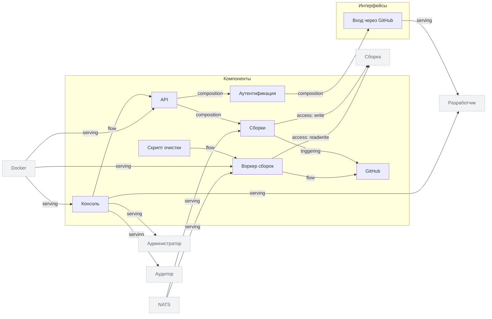

<!-- Сгенерировано командой rivet architecture views. Не редактируй вручную: файл перезаписывается. -->

# Приложения

| Элемент | Тип | Название | Описание |
|---|---|---|---|
| `app.api` | component | API |  |
| `app.api-auth` | component | Аутентификация |  |
| `app.api-builds` | component | Сборки | Ставит сборки в очередь и отдаёт их статус |
| `app.cleanup` | component | Скрипт очистки |  |
| `app.github` | component | GitHub | Хостинг репозиториев и событий push |
| `app.login` | interface | Вход через GitHub |  |
| `app.web` | component | Консоль | Веб-интерфейс платформы |
| `app.worker` | component | Воркер сборок |  |
