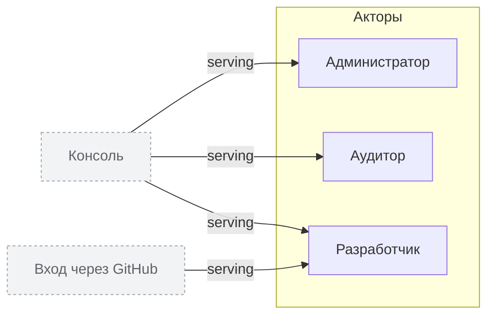

<!-- Сгенерировано командой rivet architecture views. Не редактируй вручную: файл перезаписывается. -->

# Бизнес

| Элемент | Тип | Название | Описание |
|---|---|---|---|
| `biz.admin` | actor | Администратор |  |
| `biz.auditor` | actor | Аудитор | Проверяет историю сборок снаружи компании |
| `biz.dev` | actor | Разработчик |  |
