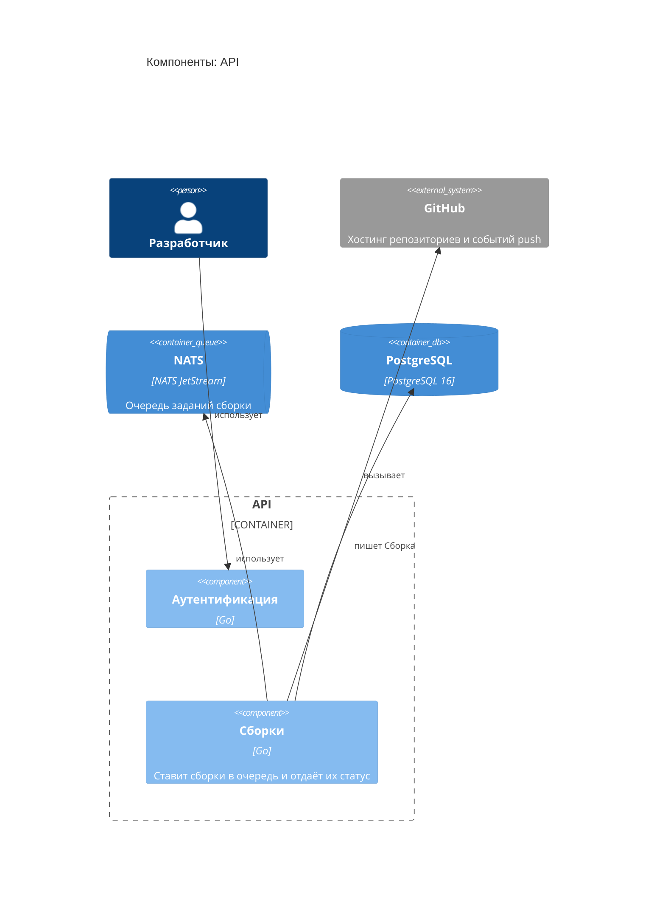

<!-- Сгенерировано командой rivet architecture views. Не редактируй вручную: файл перезаписывается. -->

# Компоненты: API

- Контейнеры: [Платформа сборок](../container/system.md)

| Элемент | Название | Вид | Технология | Описание |
|---|---|---|---|---|
| `biz.dev` | Разработчик | человек |  |  |
| `app.github` | GitHub | система, внешний |  | Хостинг репозиториев и событий push |
| `app.api` | API | контейнер | Go, net/http |  |
| `tech.nats` | NATS | очередь | NATS JetStream | Очередь заданий сборки |
| `tech.postgres` | PostgreSQL | база данных | PostgreSQL 16 |  |
| `app.api-auth` | Аутентификация | компонент | Go |  |
| `app.api-builds` | Сборки | компонент | Go | Ставит сборки в очередь и отдаёт их статус |
