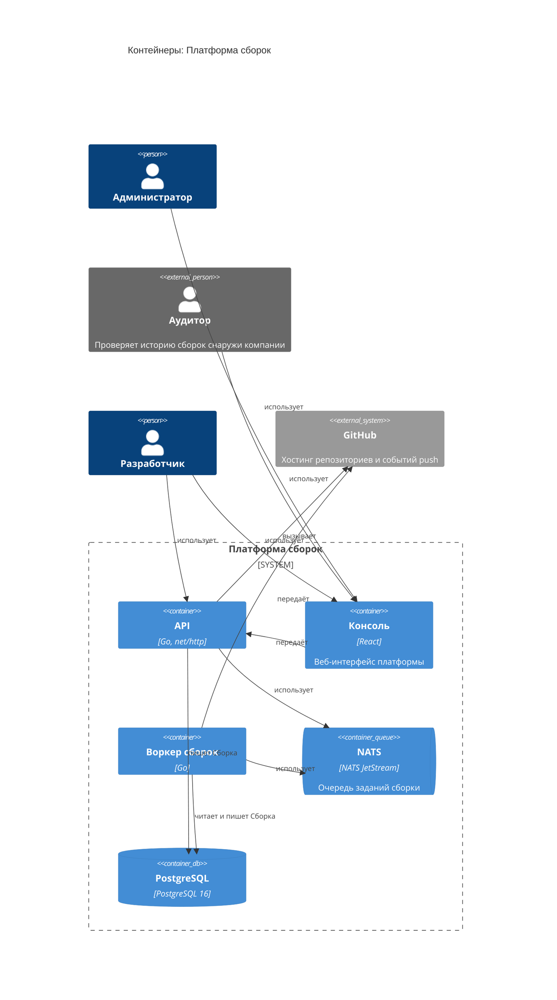

<!-- Сгенерировано командой rivet architecture views. Не редактируй вручную: файл перезаписывается. -->

# Контейнеры: Платформа сборок

- [Контекст](../context.md)
- Компоненты: [API](../component/app.api.md)

| Элемент | Название | Вид | Технология | Описание |
|---|---|---|---|---|
| `biz.admin` | Администратор | человек |  |  |
| `biz.auditor` | Аудитор | человек, внешний |  | Проверяет историю сборок снаружи компании |
| `biz.dev` | Разработчик | человек |  |  |
| `system` | Платформа сборок | система |  | Собирает проекты разработчиков по событиям из GitHub и хранит историю сборок |
| `app.github` | GitHub | система, внешний |  | Хостинг репозиториев и событий push |
| `app.api` | API | контейнер | Go, net/http |  |
| `app.web` | Консоль | контейнер | React | Веб-интерфейс платформы |
| `app.worker` | Воркер сборок | контейнер | Go |  |
| `tech.nats` | NATS | очередь | NATS JetStream | Очередь заданий сборки |
| `tech.postgres` | PostgreSQL | база данных | PostgreSQL 16 |  |
