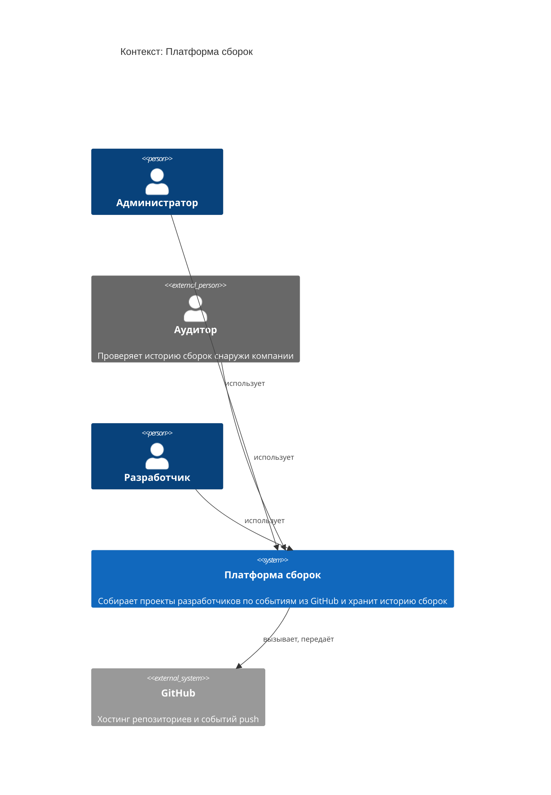

<!-- Сгенерировано командой rivet architecture views. Не редактируй вручную: файл перезаписывается. -->

# Контекст: Платформа сборок

- Контейнеры: [Платформа сборок](container/system.md)
- [Развёртывание](deployment.md)

| Элемент | Название | Вид | Технология | Описание |
|---|---|---|---|---|
| `biz.admin` | Администратор | человек |  |  |
| `biz.auditor` | Аудитор | человек, внешний |  | Проверяет историю сборок снаружи компании |
| `biz.dev` | Разработчик | человек |  |  |
| `system` | Платформа сборок | система |  | Собирает проекты разработчиков по событиям из GitHub и хранит историю сборок |
| `app.github` | GitHub | система, внешний |  | Хостинг репозиториев и событий push |
