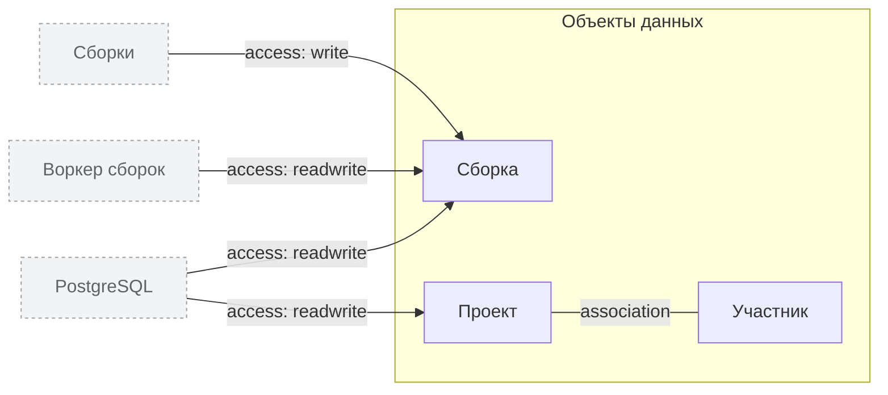

<!-- Сгенерировано командой rivet architecture views. Не редактируй вручную: файл перезаписывается. -->

# Данные

| Элемент | Тип | Название | Описание |
|---|---|---|---|
| `data.build` | data-object | Сборка |  |
| `data.member` | data-object | Участник | Учётная запись GitHub, приходит из OAuth и в базе не хранится |
| `data.project` | data-object | Проект |  |
