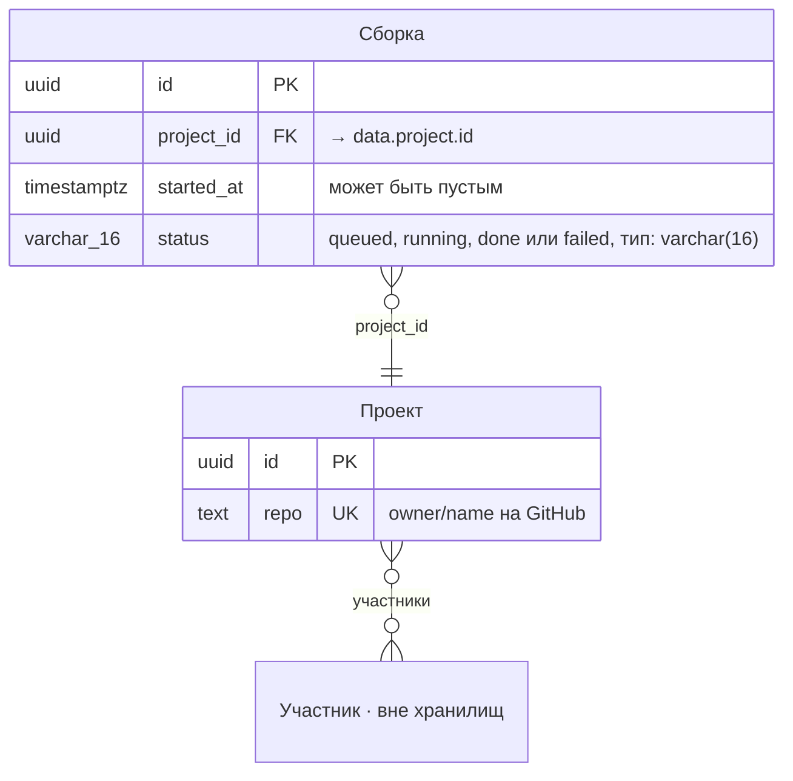

<!-- Сгенерировано командой rivet architecture views. Не редактируй вручную: файл перезаписывается. -->

# Данные: PostgreSQL (`tech.postgres`)

Объекты данных хранилища и их связи. [Общая схема](all.md).

## Сборка (`data.build`)

Хранится в: PostgreSQL.

| Атрибут | Тип | Ключ | Пусто | Описание |
|---|---|---|---|---|
| `id` | uuid | PK | нет |  |
| `project_id` | uuid | FK → `data.project.id` | нет |  |
| `started_at` | timestamptz |  | да |  |
| `status` | varchar(16) |  | нет | queued, running, done или failed |

## Проект (`data.project`)

Хранится в: PostgreSQL.

| Атрибут | Тип | Ключ | Пусто | Описание |
|---|---|---|---|---|
| `id` | uuid | PK | нет |  |
| `repo` | text | UK | нет | owner/name на GitHub |
