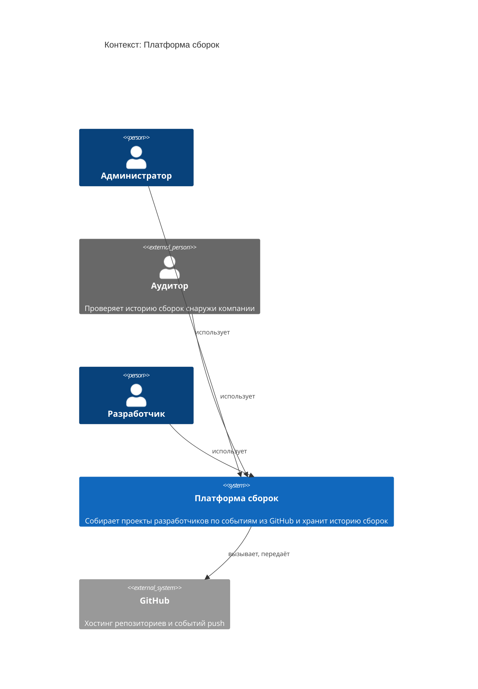
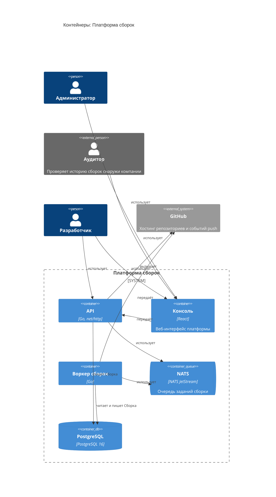
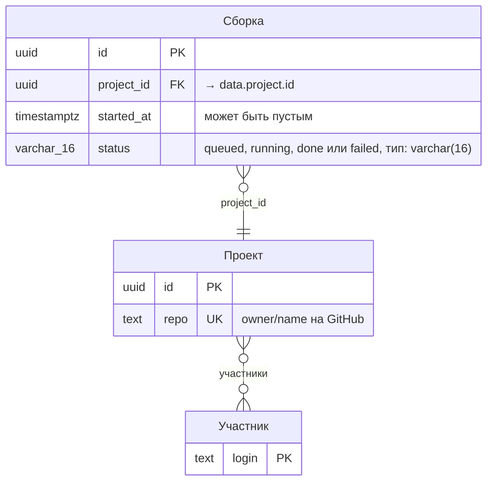
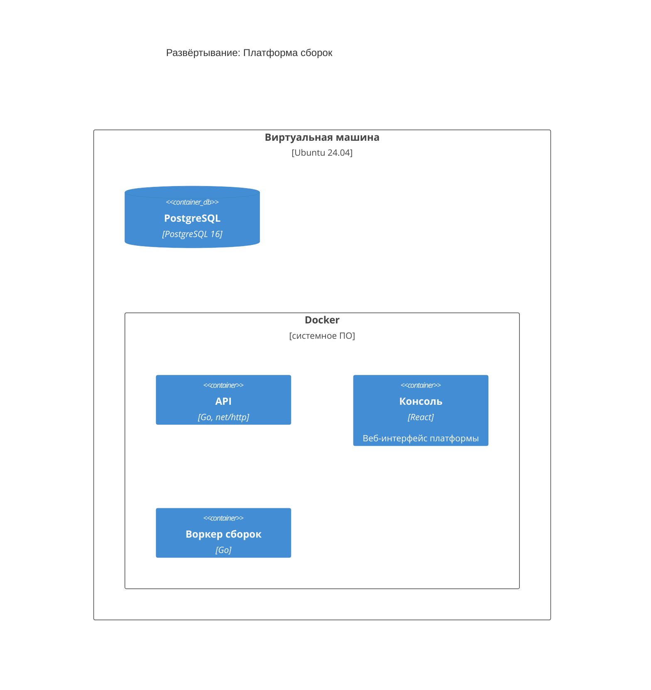

<!-- Сгенерировано командой rivet architecture views. Не редактируй вручную: файл перезаписывается. -->

# HLD: Платформа сборок

Обзор архитектуры верхнего уровня. Документ собран из описания архитектуры, подробности в [C4-схемах](c4/context.md) и [представлениях слоёв](README.md).

## Назначение и принципы

Собирает проекты разработчиков по событиям из GitHub и хранит историю сборок

| Принцип | Формулировка | Обоснование |
|---|---|---|
| `p.async-builds` | Сборки идут асинхронно через очередь |  |

## Контекст (L1)

Подробнее: [c4/context.md](c4/context.md).

## Контейнеры (L2)

| Контейнер | Вид | Технология | Описание |
|---|---|---|---|
| API (`app.api`) | контейнер | Go, net/http |  |
| Консоль (`app.web`) | контейнер | React | Веб-интерфейс платформы |
| Воркер сборок (`app.worker`) | контейнер | Go |  |
| NATS (`tech.nats`) | очередь | NATS JetStream | Очередь заданий сборки |
| PostgreSQL (`tech.postgres`) | база данных | PostgreSQL 16 |  |

## Ключевые бизнес-процессы

В описании нет бизнес-процессов.

## Данные

| Объект данных | Читают | Пишут | Хранится в |
|---|---|---|---|
| Сборка (`data.build`) | Воркер сборок | Воркер сборок, Сборки | PostgreSQL |
| Участник (`data.member`) | нет | нет | не указано |
| Проект (`data.project`) | нет | нет | PostgreSQL |

ERD: [общая схема](erd/all.md), по хранилищам: [PostgreSQL](erd/tech.postgres.md).

## Развёртывание

Подробнее: [c4/deployment.md](c4/deployment.md).

## Внешние интеграции

| Внешняя система | Описание | Связи |
|---|---|---|
| GitHub (`app.github`) | Хостинг репозиториев и событий push | Платформа сборок → GitHub: вызывает, передаёт |

## Ключевые сценарии

| Сценарий | Участники | Представление |
|---|---|---|
| Сборка проекта воркером (`sc.build-run`) | Воркер сборок, GitHub, PostgreSQL, Разработчик, Консоль, API | [scenarios/sc.build-run.md](scenarios/sc.build-run.md) |
| Запуск сборки по push (`sc.build-trigger`) | GitHub, API, PostgreSQL, NATS, Воркер сборок | [scenarios/sc.build-trigger.md](scenarios/sc.build-trigger.md) |

## Архитектурные решения

Принятые решения. Полный журнал со всеми статусами: [adr.md](adr.md).

- [0001. История сборок в PostgreSQL](../adr/0001-postgres-history.md)
- [0003. События push через вебхуки GitHub](../adr/0003-github-webhooks.md)

## Изменения архитектуры в работе

Изменений в работе нет.
