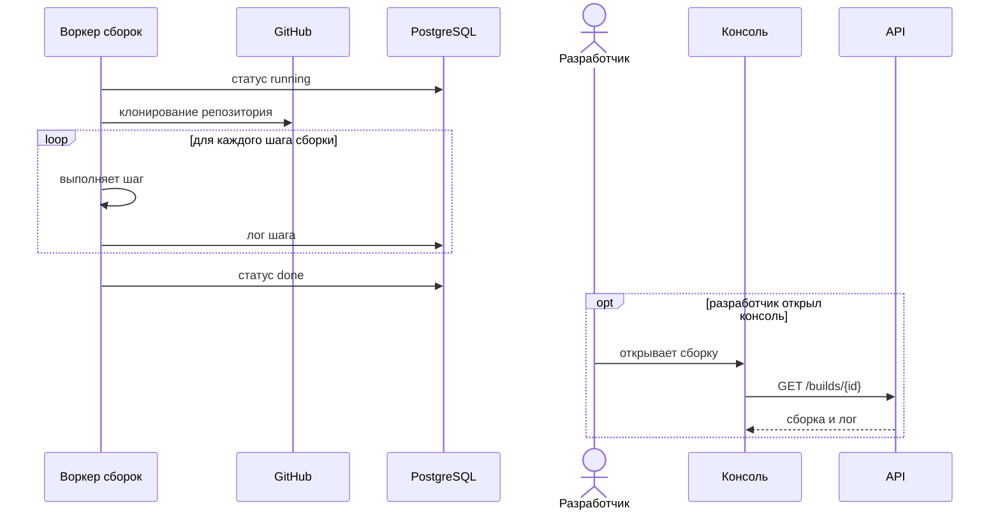

<!-- Сгенерировано командой rivet architecture views. Не редактируй вручную: файл перезаписывается. -->

# Сценарий: Сборка проекта воркером

| Участник | Элемент | Вид |
|---|---|---|
| Воркер сборок | `app.worker` | участник |
| GitHub | `app.github` | участник |
| PostgreSQL | `tech.postgres` | участник |
| Разработчик | `biz.dev` | человек |
| Консоль | `app.web` | участник |
| API | `app.api` | участник |
