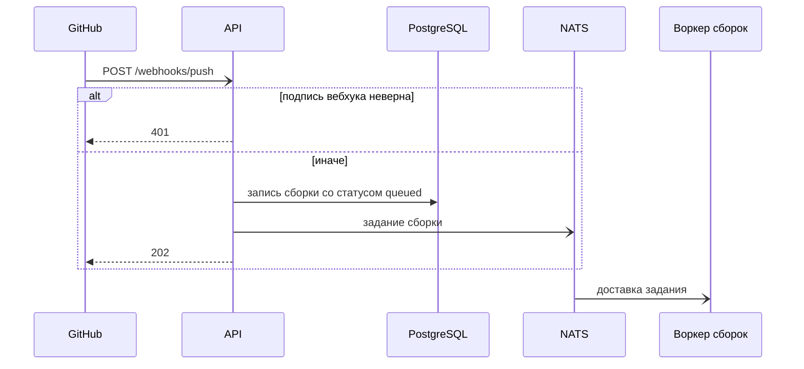

<!-- Сгенерировано командой rivet architecture views. Не редактируй вручную: файл перезаписывается. -->

# Сценарий: Запуск сборки по push

GitHub сообщает о push, API ставит сборку в очередь, воркер её забирает.

| Участник | Элемент | Вид |
|---|---|---|
| GitHub | `app.github` | участник |
| API | `app.api` | участник |
| PostgreSQL | `tech.postgres` | участник |
| NATS | `tech.nats` | участник |
| Воркер сборок | `app.worker` | участник |
