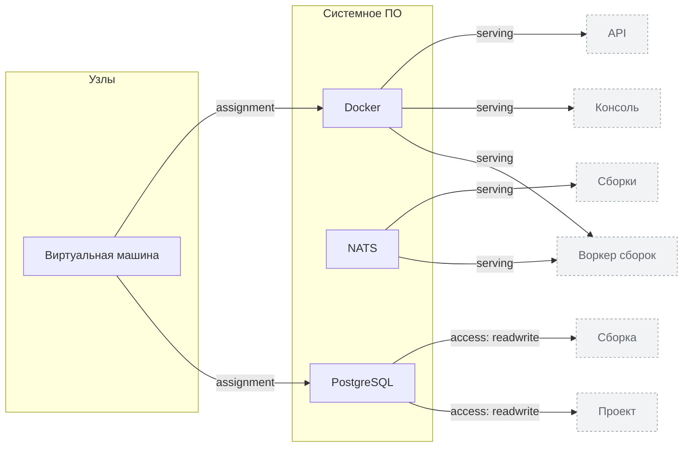

<!-- Сгенерировано командой rivet architecture views. Не редактируй вручную: файл перезаписывается. -->

# Технологии

| Элемент | Тип | Название | Описание |
|---|---|---|---|
| `tech.docker` | system-software | Docker |  |
| `tech.nats` | system-software | NATS | Очередь заданий сборки |
| `tech.postgres` | system-software | PostgreSQL |  |
| `tech.vm` | node | Виртуальная машина |  |
