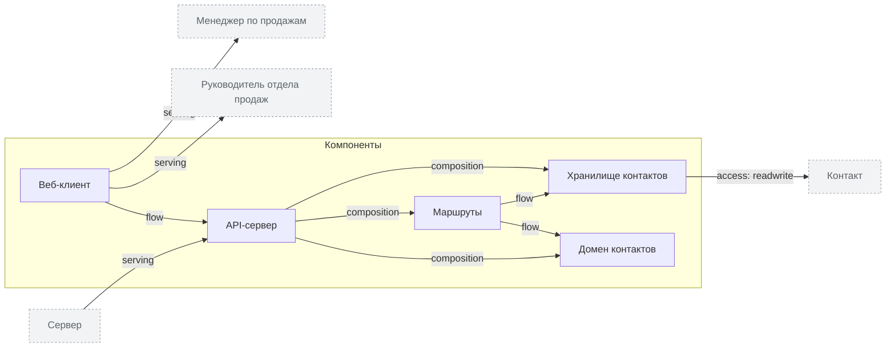

<!-- Сгенерировано командой rivet architecture views. Не редактируй вручную: файл перезаписывается. -->

# Приложения

| Элемент | Тип | Название | Описание |
|---|---|---|---|
| `app.api` | component | API-сервер | JSON API и раздача статики веб-клиента на одном порту (server/) |
| `app.api-domain` | component | Домен контактов | Создание, правка и проверка полей контакта, чистые функции (server/domain) |
| `app.api-routes` | component | Маршруты | Обработчики /api/health и /api/contacts (server/routes) |
| `app.api-storage` | component | Хранилище контактов | Чтение и атомарная запись JSON-файла, очередь записей (server/storage/json-store.js) |
| `app.web` | component | Веб-клиент | Список контактов с поиском и постраничной загрузкой, форма добавления (web/) |
