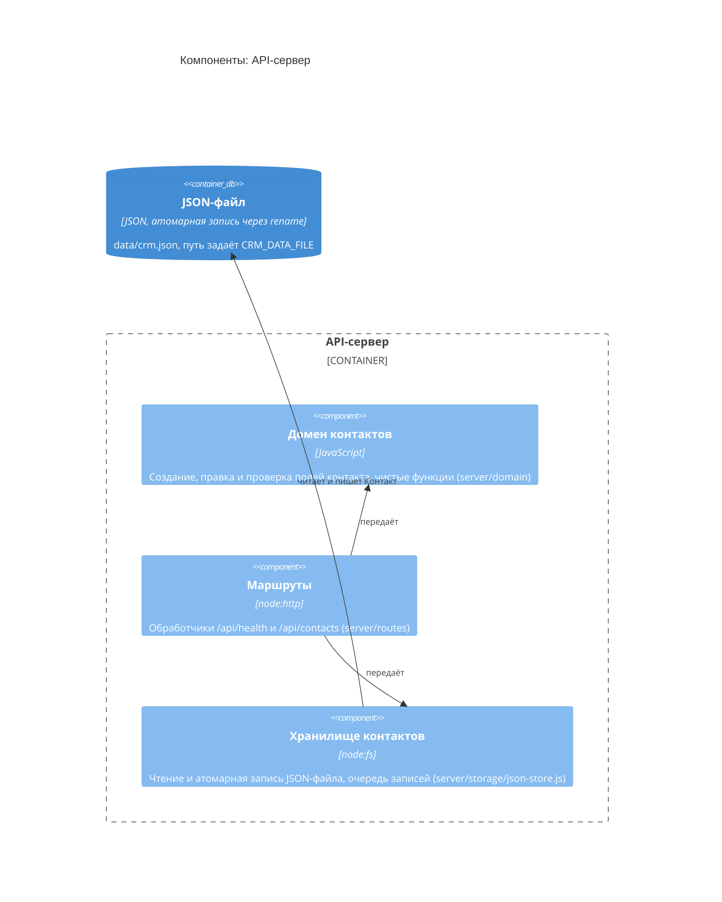

<!-- Сгенерировано командой rivet architecture views. Не редактируй вручную: файл перезаписывается. -->

# Компоненты: API-сервер

- Контейнеры: [CRM](../container/system.md)

| Элемент | Название | Вид | Технология | Описание |
|---|---|---|---|---|
| `app.api` | API-сервер | контейнер | Node.js, node:http | JSON API и раздача статики веб-клиента на одном порту (server/) |
| `tech.json-file` | JSON-файл | база данных | JSON, атомарная запись через rename | data/crm.json, путь задаёт CRM_DATA_FILE |
| `app.api-domain` | Домен контактов | компонент | JavaScript | Создание, правка и проверка полей контакта, чистые функции (server/domain) |
| `app.api-routes` | Маршруты | компонент | node:http | Обработчики /api/health и /api/contacts (server/routes) |
| `app.api-storage` | Хранилище контактов | компонент | node:fs | Чтение и атомарная запись JSON-файла, очередь записей (server/storage/json-store.js) |
