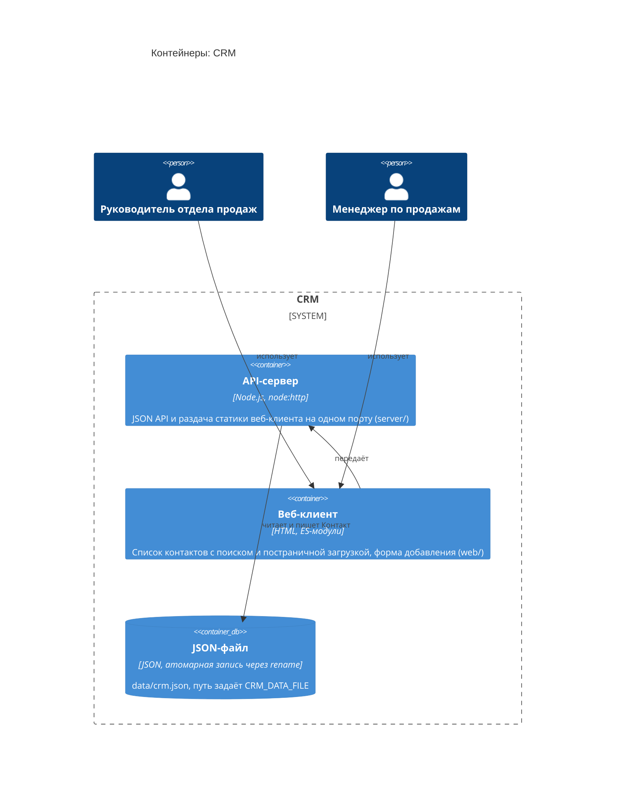

<!-- Сгенерировано командой rivet architecture views. Не редактируй вручную: файл перезаписывается. -->

# Контейнеры: CRM

- [Контекст](../context.md)
- Компоненты: [API-сервер](../component/app.api.md)

| Элемент | Название | Вид | Технология | Описание |
|---|---|---|---|---|
| `biz.head` | Руководитель отдела продаж | человек |  |  |
| `biz.manager` | Менеджер по продажам | человек |  |  |
| `system` | CRM | система |  | Учёт клиентов и контактов для небольшого отдела продаж. Один процесс Node.js раздаёт веб-клиент и JSON API, данные лежат в JSON-файле. |
| `app.api` | API-сервер | контейнер | Node.js, node:http | JSON API и раздача статики веб-клиента на одном порту (server/) |
| `app.web` | Веб-клиент | контейнер | HTML, ES-модули | Список контактов с поиском и постраничной загрузкой, форма добавления (web/) |
| `tech.json-file` | JSON-файл | база данных | JSON, атомарная запись через rename | data/crm.json, путь задаёт CRM_DATA_FILE |
