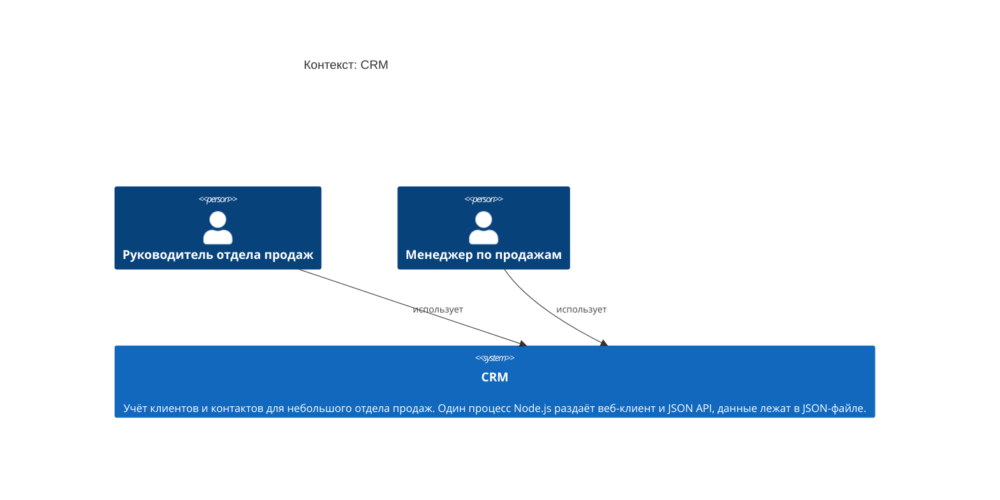

<!-- Сгенерировано командой rivet architecture views. Не редактируй вручную: файл перезаписывается. -->

# Контекст: CRM

- Контейнеры: [CRM](container/system.md)
- [Развёртывание](deployment.md)

| Элемент | Название | Вид | Технология | Описание |
|---|---|---|---|---|
| `biz.head` | Руководитель отдела продаж | человек |  |  |
| `biz.manager` | Менеджер по продажам | человек |  |  |
| `system` | CRM | система |  | Учёт клиентов и контактов для небольшого отдела продаж. Один процесс Node.js раздаёт веб-клиент и JSON API, данные лежат в JSON-файле. |
