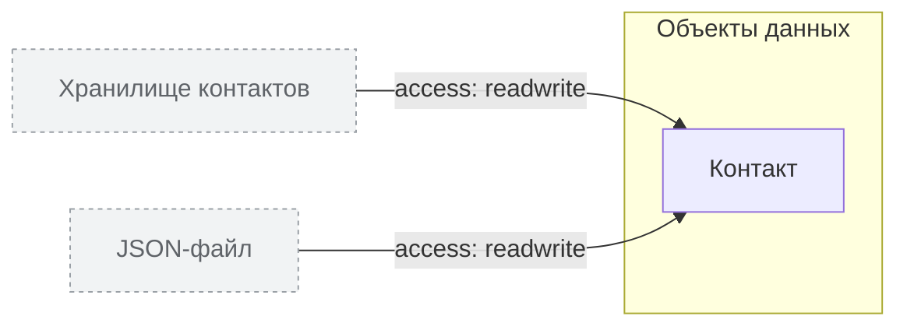

<!-- Сгенерировано командой rivet architecture views. Не редактируй вручную: файл перезаписывается. -->

# Данные

| Элемент | Тип | Название | Описание |
|---|---|---|---|
| `data.contact` | data-object | Контакт | Запись server/domain/contacts.js, хранится массивом в data/crm.json |
