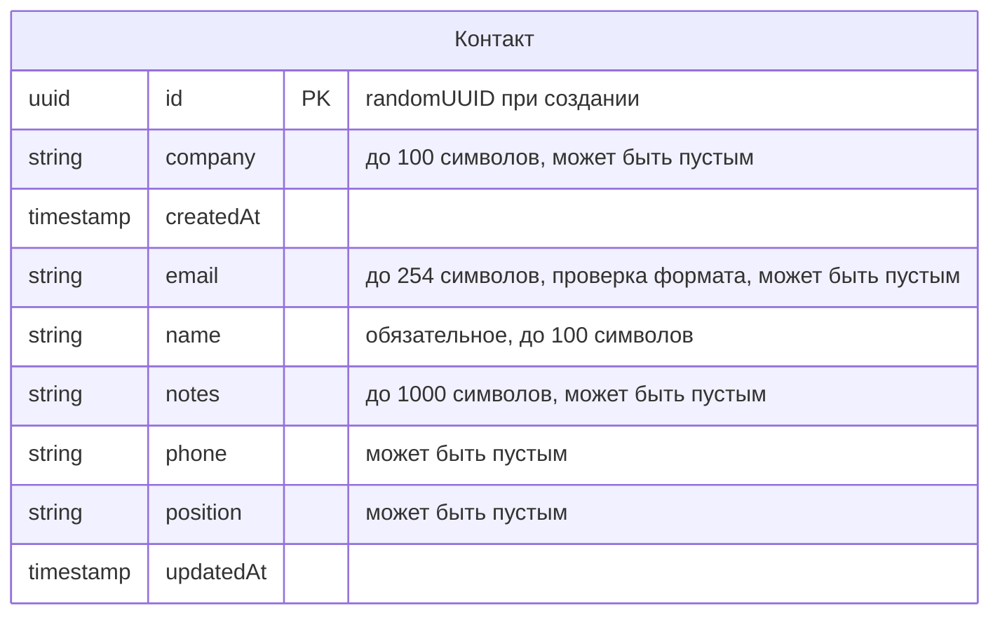

<!-- Сгенерировано командой rivet architecture views. Не редактируй вручную: файл перезаписывается. -->

# Данные: JSON-файл (`tech.json-file`)

Объекты данных хранилища и их связи. [Общая схема](all.md).

## Контакт (`data.contact`)

Хранится в: JSON-файл.

| Атрибут | Тип | Ключ | Пусто | Описание |
|---|---|---|---|---|
| `id` | uuid | PK | нет | randomUUID при создании |
| `company` | string |  | да | до 100 символов |
| `createdAt` | timestamp |  | нет |  |
| `email` | string |  | да | до 254 символов, проверка формата |
| `name` | string |  | нет | обязательное, до 100 символов |
| `notes` | string |  | да | до 1000 символов |
| `phone` | string |  | да |  |
| `position` | string |  | да |  |
| `updatedAt` | timestamp |  | нет |  |
