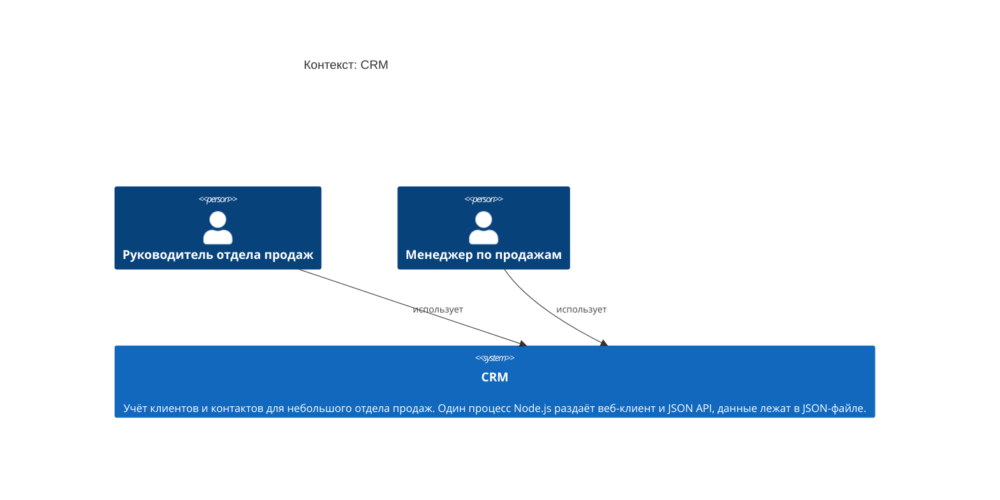
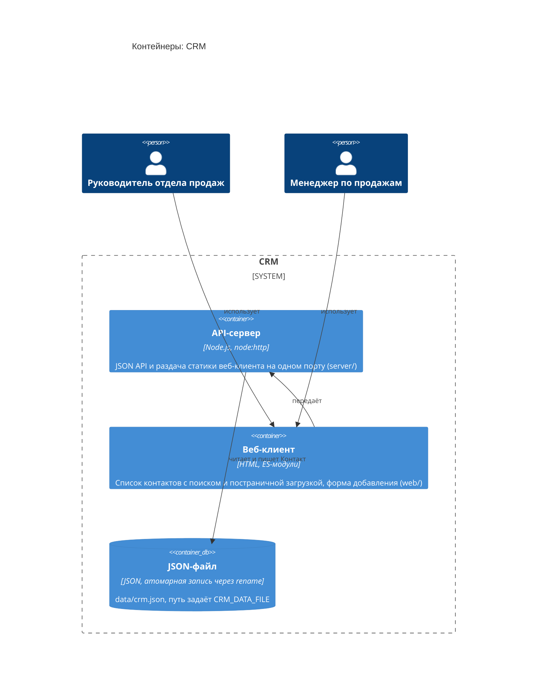
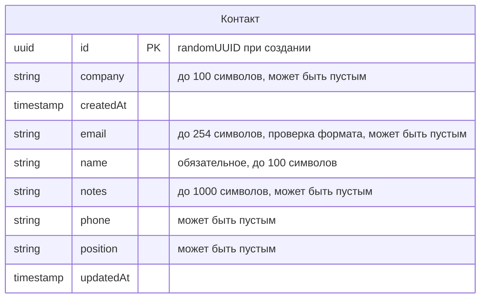
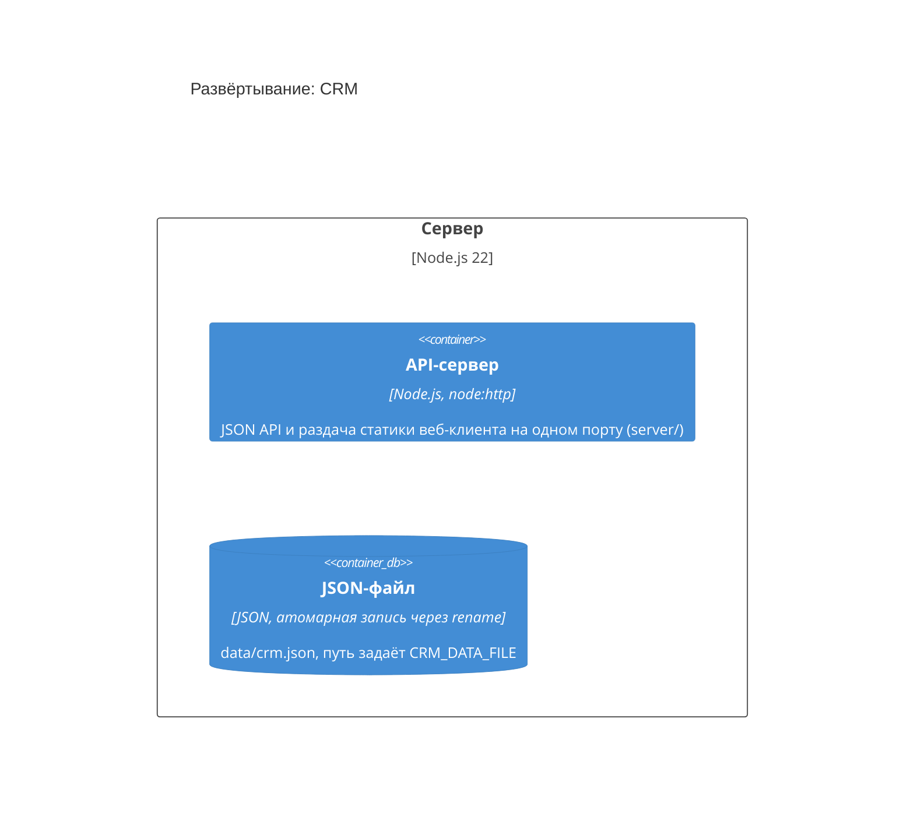

<!-- Сгенерировано командой rivet architecture views. Не редактируй вручную: файл перезаписывается. -->

# HLD: CRM

Обзор архитектуры верхнего уровня. Документ собран из описания архитектуры, подробности в [C4-схемах](c4/context.md) и [представлениях слоёв](README.md).

## Назначение и принципы

Учёт клиентов и контактов для небольшого отдела продаж. Один процесс Node.js раздаёт веб-клиент и JSON API, данные лежат в JSON-файле.

| Принцип | Формулировка | Обоснование |
|---|---|---|
| `p.no-deps` | Без внешних зависимостей | Только встроенные модули Node.js, установка и запуск одной командой |

## Контекст (L1)

Подробнее: [c4/context.md](c4/context.md).

## Контейнеры (L2)

| Контейнер | Вид | Технология | Описание |
|---|---|---|---|
| API-сервер (`app.api`) | контейнер | Node.js, node:http | JSON API и раздача статики веб-клиента на одном порту (server/) |
| Веб-клиент (`app.web`) | контейнер | HTML, ES-модули | Список контактов с поиском и постраничной загрузкой, форма добавления (web/) |
| JSON-файл (`tech.json-file`) | база данных | JSON, атомарная запись через rename | data/crm.json, путь задаёт CRM_DATA_FILE |

## Ключевые бизнес-процессы

В описании нет бизнес-процессов.

## Данные

| Объект данных | Читают | Пишут | Хранится в |
|---|---|---|---|
| Контакт (`data.contact`) | Хранилище контактов | Хранилище контактов | JSON-файл |

ERD: [общая схема](erd/all.md), по хранилищам: [JSON-файл](erd/tech.json-file.md).

## Развёртывание

Подробнее: [c4/deployment.md](c4/deployment.md).

## Внешние интеграции

Внешних систем в описании нет.

## Ключевые сценарии

| Сценарий | Участники | Представление |
|---|---|---|
| Создание контакта (`sc.contact-create`) | Менеджер по продажам, Веб-клиент, Маршруты, Домен контактов, Хранилище контактов, JSON-файл | [scenarios/sc.contact-create.md](scenarios/sc.contact-create.md) |
| Просмотр списка контактов (`sc.contact-list`) | Менеджер по продажам, Веб-клиент, Маршруты, Хранилище контактов | [scenarios/sc.contact-list.md](scenarios/sc.contact-list.md) |

## Архитектурные решения

Принятые решения. Полный журнал со всеми статусами: [adr.md](adr.md).

- [0001. Хранилище в JSON-файле](../adr/0001-json-storage.md)
- [0002. Node.js без внешних зависимостей](../adr/0002-node-no-deps.md)

## Изменения архитектуры в работе

Изменений в работе нет.
