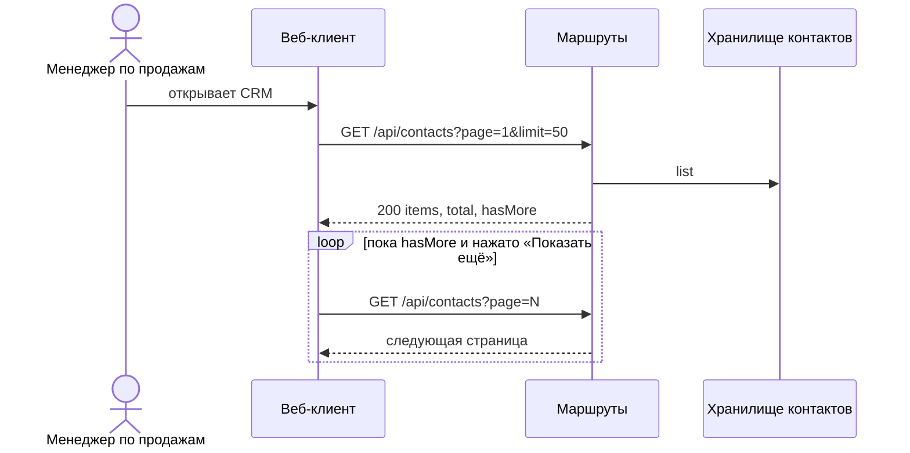

<!-- Сгенерировано командой rivet architecture views. Не редактируй вручную: файл перезаписывается. -->

# Сценарий: Просмотр списка контактов

Список грузится страницами по 50 контактов, следующая страница по кнопке «Показать ещё».

| Участник | Элемент | Вид |
|---|---|---|
| Менеджер по продажам | `biz.manager` | человек |
| Веб-клиент | `app.web` | участник |
| Маршруты | `app.api-routes` | участник |
| Хранилище контактов | `app.api-storage` | участник |
