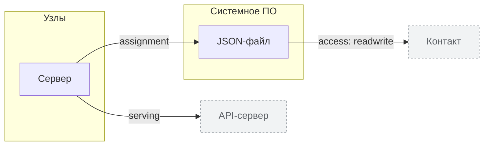

<!-- Сгенерировано командой rivet architecture views. Не редактируй вручную: файл перезаписывается. -->

# Технологии

| Элемент | Тип | Название | Описание |
|---|---|---|---|
| `tech.host` | node | Сервер |  |
| `tech.json-file` | system-software | JSON-файл | data/crm.json, путь задаёт CRM_DATA_FILE |
