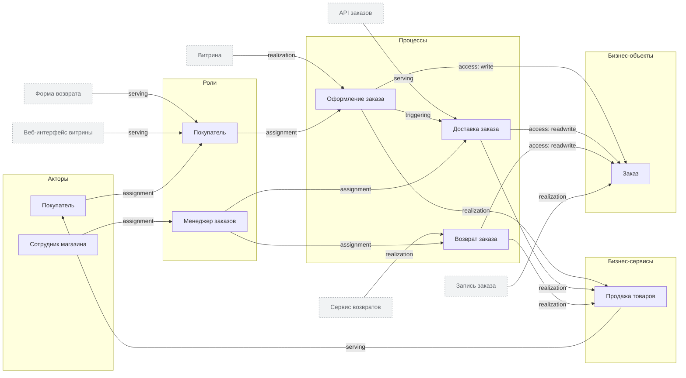

<!-- Сгенерировано командой rivet architecture views. Не редактируй вручную: файл перезаписывается. -->

# Бизнес

| Элемент | Тип | Название | Описание |
|---|---|---|---|
| `biz.buyer` | role | Покупатель |  |
| `biz.checkout` | process | Оформление заказа |  |
| `biz.customer` | actor | Покупатель |  |
| `biz.delivery` | process | Доставка заказа |  |
| `biz.manager` | role | Менеджер заказов |  |
| `biz.order` | business-object | Заказ |  |
| `biz.refund` | process | Возврат заказа |  |
| `biz.sales` | business-service | Продажа товаров | Покупатель выбирает товары, оплачивает и получает заказ |
| `biz.staff` | actor | Сотрудник магазина |  |
