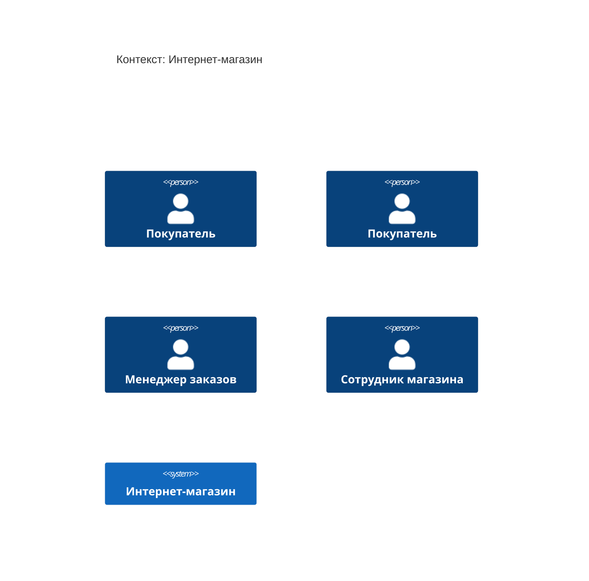

<!-- Сгенерировано командой rivet architecture views. Не редактируй вручную: файл перезаписывается. -->

# Контекст: Интернет-магазин

- Контейнеры: [Интернет-магазин](container/system.md)
- [Развёртывание](deployment.md)

| Элемент | Название | Вид | Технология | Описание |
|---|---|---|---|---|
| `biz.buyer` | Покупатель | человек |  |  |
| `biz.customer` | Покупатель | человек |  |  |
| `biz.manager` | Менеджер заказов | человек |  |  |
| `biz.staff` | Сотрудник магазина | человек |  |  |
| `system` | Интернет-магазин | система |  |  |
