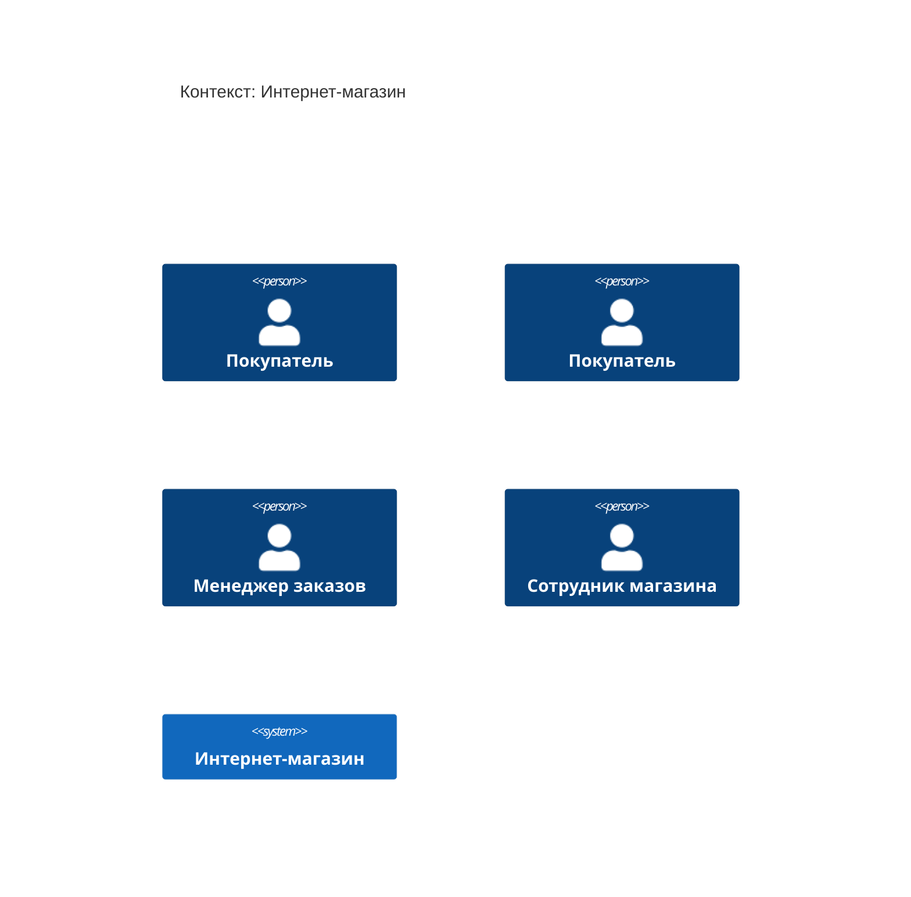
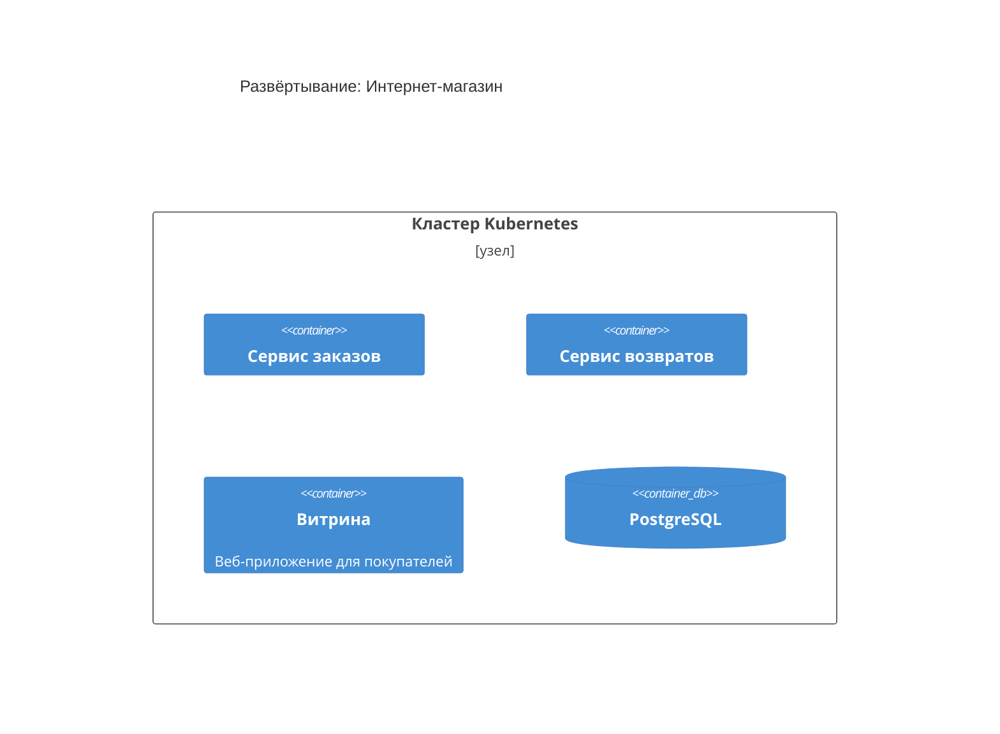

<!-- Сгенерировано командой rivet architecture views. Не редактируй вручную: файл перезаписывается. -->

# HLD: Интернет-магазин

Обзор архитектуры верхнего уровня. Документ собран из описания архитектуры, подробности в [C4-схемах](c4/context.md) и [представлениях слоёв](README.md).

## Назначение и принципы

Назначение системы не описано: заполни поле `description` в `architecture.yaml`.

| Принцип | Формулировка | Обоснование |
|---|---|---|
| `p.single-order-source` | У заказа один источник истины | Состояние заказа меняет только сервис заказов, остальные читают его через API |
| `p.buyer-first` | Покупатель не ждёт внутренние системы | Витрина отвечает покупателю сразу, долгие операции идут асинхронно |

## Контекст (L1)

Подробнее: [c4/context.md](c4/context.md).

## Контейнеры (L2)

| Контейнер | Вид | Технология | Описание |
|---|---|---|---|
| Сервис заказов (`app.orders`) | контейнер |  |  |
| Сервис возвратов (`app.refunds`) | контейнер |  |  |
| Витрина (`app.storefront`) | контейнер |  | Веб-приложение для покупателей |
| PostgreSQL (`tech.postgres`) | база данных |  |  |

## Ключевые бизнес-процессы

| Процесс | Участвуют | Представление |
|---|---|---|
| Оформление заказа (`biz.checkout`) | Покупатель | [processes/biz.checkout.md](processes/biz.checkout.md) |
| Доставка заказа (`biz.delivery`) | Менеджер заказов | [processes/biz.delivery.md](processes/biz.delivery.md) |
| Возврат заказа (`biz.refund`) | Покупатель, Менеджер заказов | [processes/biz.refund.md](processes/biz.refund.md) |

## Данные

| Объект данных | Читают | Пишут | Хранится в |
|---|---|---|---|
| Запись заказа (`data.order`) | нет | Сервис возвратов, Сервис заказов | PostgreSQL |

ERD: [общая схема](erd/all.md), по хранилищам: [PostgreSQL](erd/tech.postgres.md).

## Развёртывание

Подробнее: [c4/deployment.md](c4/deployment.md).

## Внешние интеграции

Внешних систем в описании нет.

## Ключевые сценарии

Ключевых сценариев в описании нет.

## Архитектурные решения

Архитектурных решений в описании нет.

## Изменения архитектуры в работе

Изменений в работе нет.
