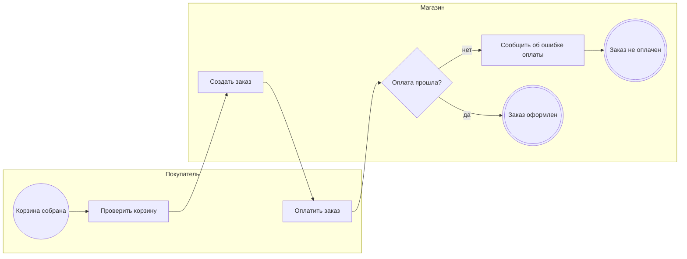

<!-- Сгенерировано командой rivet architecture views. Не редактируй вручную: файл перезаписывается. -->

# Процесс: Оформление заказа (`biz.checkout`)

| Дорожка | Элемент модели |
|---|---|
| Покупатель | `biz.buyer` |

| Сервисная задача | Элемент модели |
|---|---|
| Создать заказ | `app.order-api` |
| Сообщить об ошибке оплаты | `app.storefront` |
