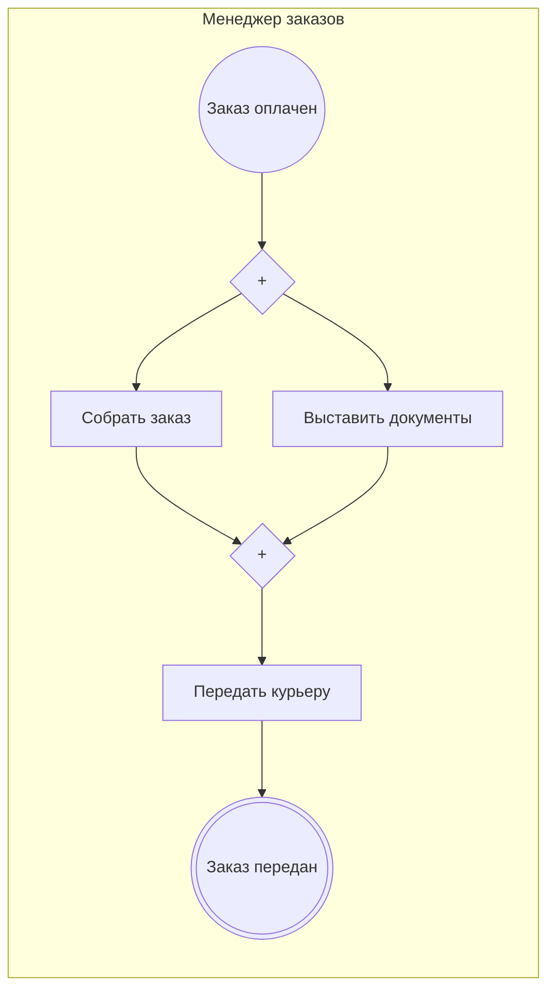

<!-- Сгенерировано командой rivet architecture views. Не редактируй вручную: файл перезаписывается. -->

# Процесс: Доставка заказа (`biz.delivery`)

| Дорожка | Элемент модели |
|---|---|
| Менеджер заказов | `biz.manager` |

| Сервисная задача | Элемент модели |
|---|---|
| Выставить документы | `app.order-api` |
