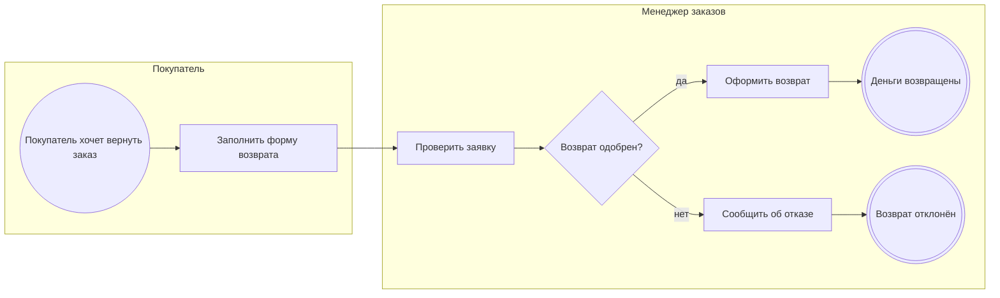

<!-- Сгенерировано командой rivet architecture views. Не редактируй вручную: файл перезаписывается. -->

# Процесс: Возврат заказа (`biz.refund`)

| Дорожка | Элемент модели |
|---|---|
| Покупатель | `biz.buyer` |
| Менеджер заказов | `biz.manager` |

| Сервисная задача | Элемент модели |
|---|---|
| Оформить возврат | `app.refunds` |
| Сообщить об отказе | `app.refunds` |
