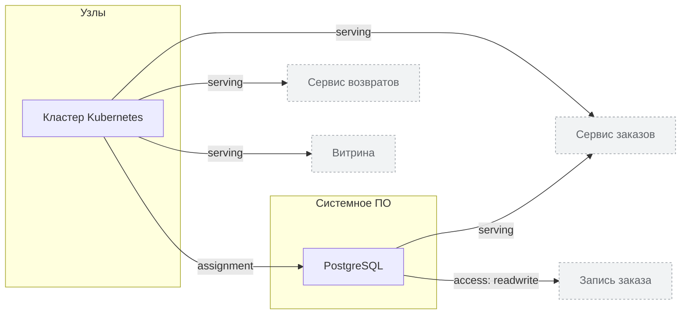

<!-- Сгенерировано командой rivet architecture views. Не редактируй вручную: файл перезаписывается. -->

# Технологии

| Элемент | Тип | Название | Описание |
|---|---|---|---|
| `tech.k8s` | node | Кластер Kubernetes |  |
| `tech.postgres` | system-software | PostgreSQL |  |
