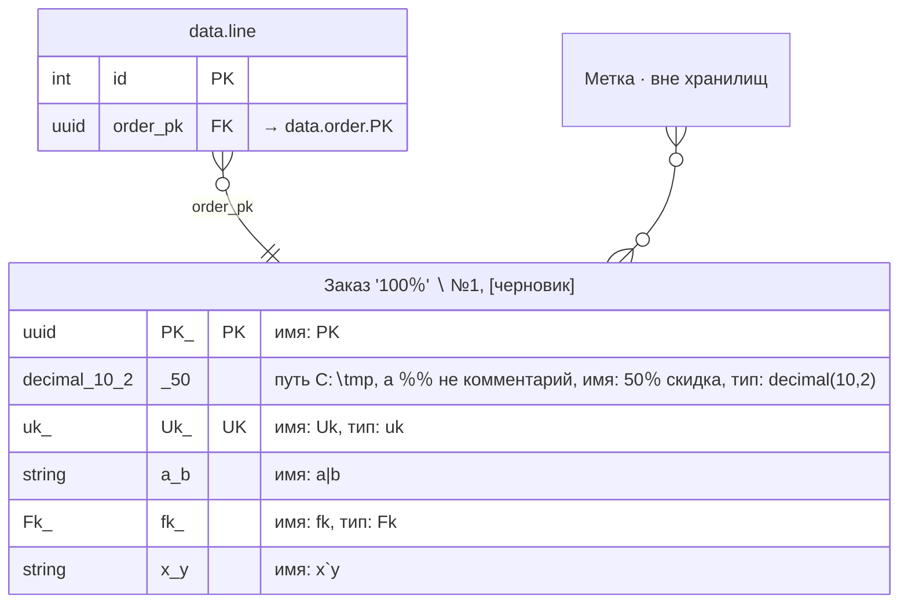

<!-- Сгенерировано командой rivet architecture views. Не редактируй вручную: файл перезаписывается. -->

# Данные: PostgreSQL [main] (`tech.pg`)

Объекты данных хранилища и их связи. [Общая схема](all.md).

## data.line (`data.line`)

Хранится в: PostgreSQL [main].

| Атрибут | Тип | Ключ | Пусто | Описание |
|---|---|---|---|---|
| `id` | int | PK | нет |  |
| `order_pk` | uuid | FK → `data.order.PK` | нет |  |

## Заказ "100%" \ #1; [черновик] (`data.order`)

Хранится в: PostgreSQL [main].

| Атрибут | Тип | Ключ | Пусто | Описание |
|---|---|---|---|---|
| `PK` | uuid | PK | нет |  |
| `50% скидка` | decimal(10,2) |  | нет | путь C:\tmp, а %% не комментарий |
| `Uk` | uk | UK | нет |  |
| `a\|b` | string |  | нет |  |
| `fk` | Fk |  | нет |  |
| `` x`y `` | string |  | нет |  |
