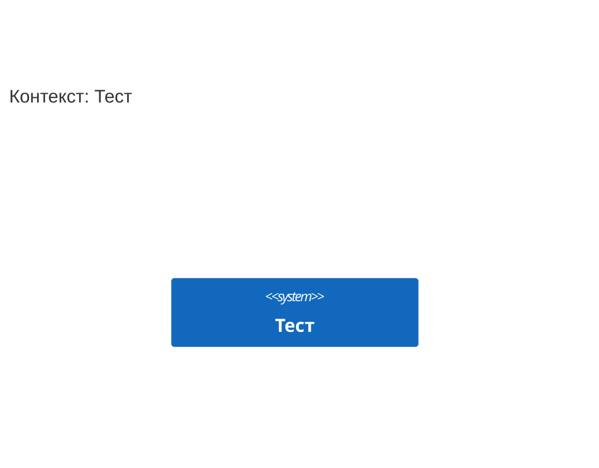

<!-- Сгенерировано командой rivet architecture views. Не редактируй вручную: файл перезаписывается. -->

# HLD: Тест

Обзор архитектуры верхнего уровня. Документ собран из описания архитектуры, подробности в [C4-схемах](c4/context.md) и [представлениях слоёв](README.md).

## Назначение и принципы

Назначение системы не описано: заполни поле `description` в `architecture.yaml`.

Принципы архитектуры не заданы.

## Контекст (L1)

Подробнее: [c4/context.md](c4/context.md).

## Контейнеры (L2)

В описании нет контейнеров: компоненты слоя приложений не описаны.

## Ключевые бизнес-процессы

В описании нет бизнес-процессов.

## Данные

В описании нет объектов данных.

## Развёртывание

Развёртывание не описано: в слое технологий нет узлов.

## Внешние интеграции

Внешних систем в описании нет.

## Ключевые сценарии

Ключевых сценариев в описании нет.

## Архитектурные решения

Архитектурных решений в описании нет.

## Изменения архитектуры в работе

Изменений в работе нет.
