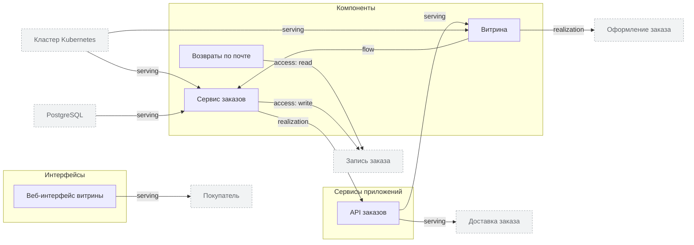

<!-- Сгенерировано командой rivet architecture views. Не редактируй вручную: файл перезаписывается. -->

# Приложения

| Элемент | Тип | Название | Описание |
|---|---|---|---|
| `app.mail-refunds` | component | Возвраты по почте | Скрипт, который разбирает письма о возвратах |
| `app.order-api` | application-service | API заказов |  |
| `app.orders` | component | Сервис заказов |  |
| `app.storefront` | component | Витрина | Веб-приложение для покупателей |
| `app.web-ui` | interface | Веб-интерфейс витрины |  |
