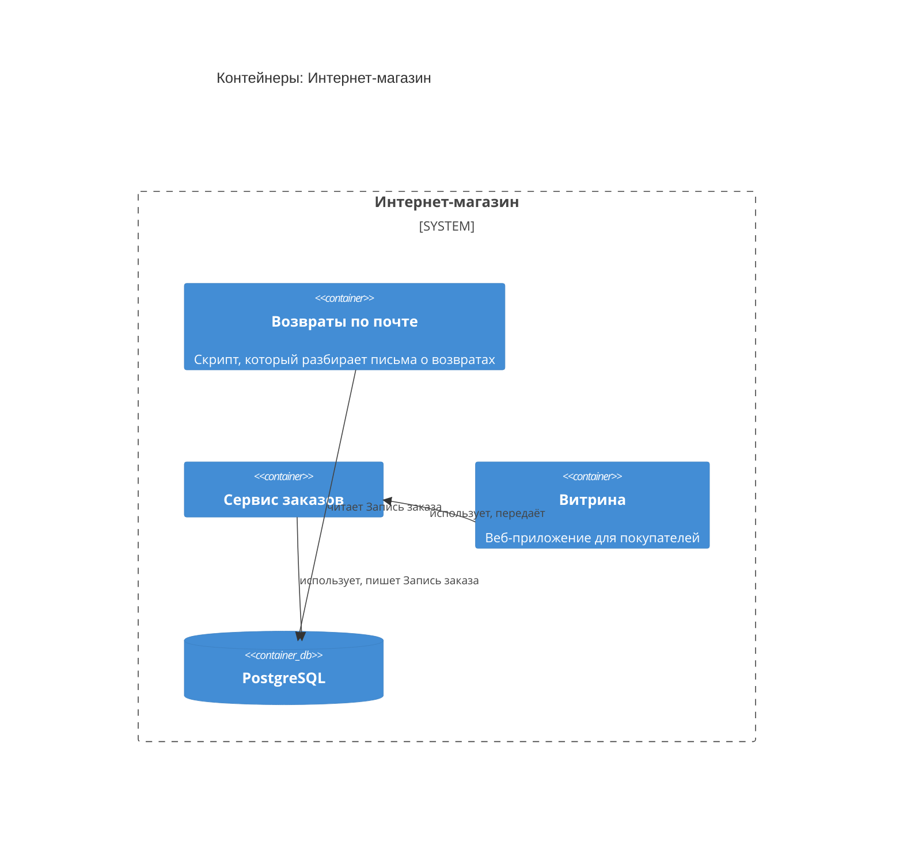

<!-- Сгенерировано командой rivet architecture views. Не редактируй вручную: файл перезаписывается. -->

# Контейнеры: Интернет-магазин

- [Контекст](../context.md)

| Элемент | Название | Вид | Технология | Описание |
|---|---|---|---|---|
| `system` | Интернет-магазин | система |  |  |
| `app.mail-refunds` | Возвраты по почте | контейнер |  | Скрипт, который разбирает письма о возвратах |
| `app.orders` | Сервис заказов | контейнер |  |  |
| `app.storefront` | Витрина | контейнер |  | Веб-приложение для покупателей |
| `tech.postgres` | PostgreSQL | база данных |  |  |
