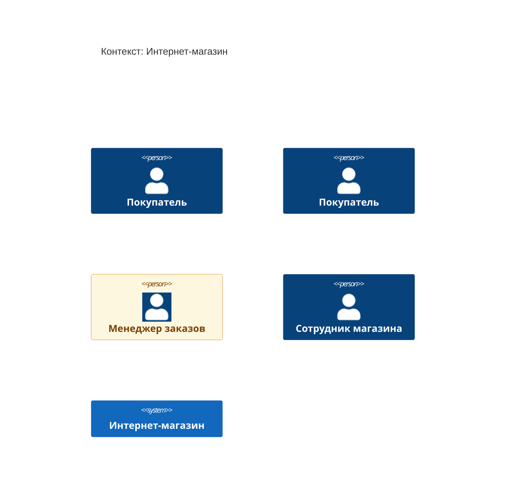
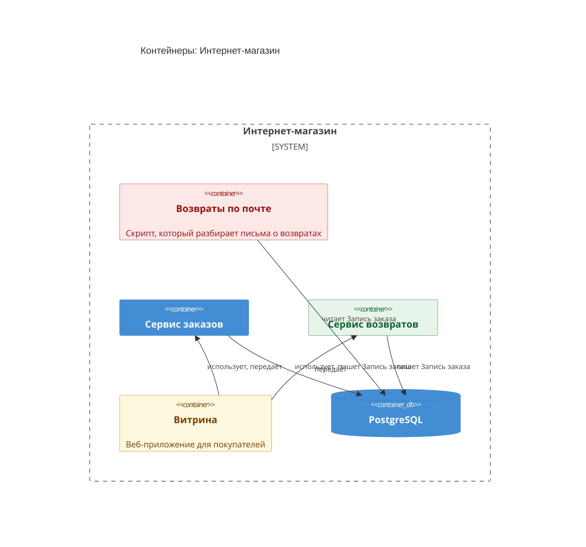

<!-- Сгенерировано командой rivet architecture views. Не редактируй вручную: файл перезаписывается. -->

# C4 изменения: Возвраты заказов (`refunds`)

Целевая архитектура после изменения. Описание изменения: [refunds.md](refunds.md).

## Контекст: Интернет-магазин

## Контейнеры: Интернет-магазин

## Легенда

| Цвет рамки | Состояние |
|---|---|
| `#1e8e3e` | добавлено |
| `#e37400` | изменено |
| `#d93025` | удалено, оставлено на схеме для наглядности |
