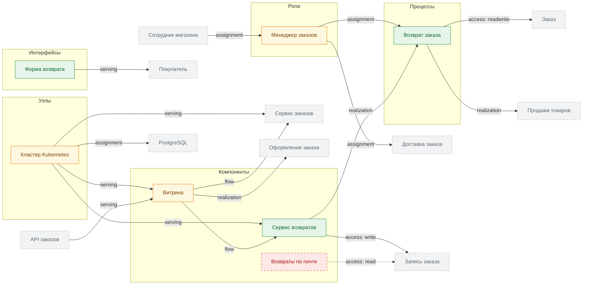
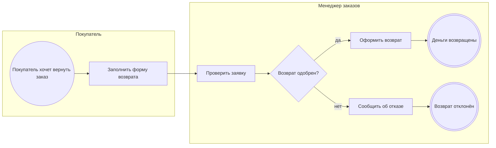

<!-- Сгенерировано командой rivet architecture views. Не редактируй вручную: файл перезаписывается. -->

# Изменение: Возвраты заказов (`refunds`)

## Видение

### Цель

Покупатель оформляет возврат на сайте, а не письмом. Заявку проверяет менеджер заказов, а результат попадает в учёт заказа.

### Рамки

Возврат заказа целиком. Частичные возвраты и обмен товара в изменение не входят.

### Заинтересованные лица

Покупатели, менеджеры заказов, бухгалтерия.

## Целевая модель

Зелёным отмечены добавленные элементы, жёлтым изменённые, красным пунктиром удалённые. Серым пунктиром показаны соседние элементы без изменений.

## Разрывы

| Разрыв | Вид | Название | Элементы | Процессы |
|---|---|---|---|---|
| `gap.mail-refunds` | remove | Разбор писем о возвратах больше не нужен | `app.mail-refunds` |  |
| `gap.refund-process` | add | Нет процесса возврата | `biz.refund`, `biz.manager` | `biz.refund` |
| `gap.refund-service` | add | Нет сервиса и формы возврата | `app.refunds`, `app.refund-form`, `app.storefront`, `tech.k8s`, `sec.refund-fraud` |  |

## Записи дельты

| Запись | Viewpoint | Изменение | Описание |
|---|---|---|---|
| `app.mail-refunds` | application | удалён | Возвраты переезжают в сервис возвратов |
| `app.refund-form` | application | добавлен | Форма возврата |
| `app.refunds` | application | добавлен | Сервис возвратов |
| `app.storefront` | application | изменён | Витрина |
| `biz.manager` | business | изменён | Менеджер заказов |
| `biz.refund` | business | добавлен | Возврат заказа |
| `sec.refund-fraud` | security | добавлен | Возврат чужого заказа |
| `tech.k8s` | technology | изменён | Кластер Kubernetes |

## Целевые процессы

### Возврат заказа (`biz.refund`)

| Дорожка | Элемент модели |
|---|---|
| Покупатель | `biz.buyer` |
| Менеджер заказов | `biz.manager` |

| Сервисная задача | Элемент модели |
|---|---|
| Оформить возврат | `app.refunds` |
| Сообщить об отказе | `app.refunds` |
